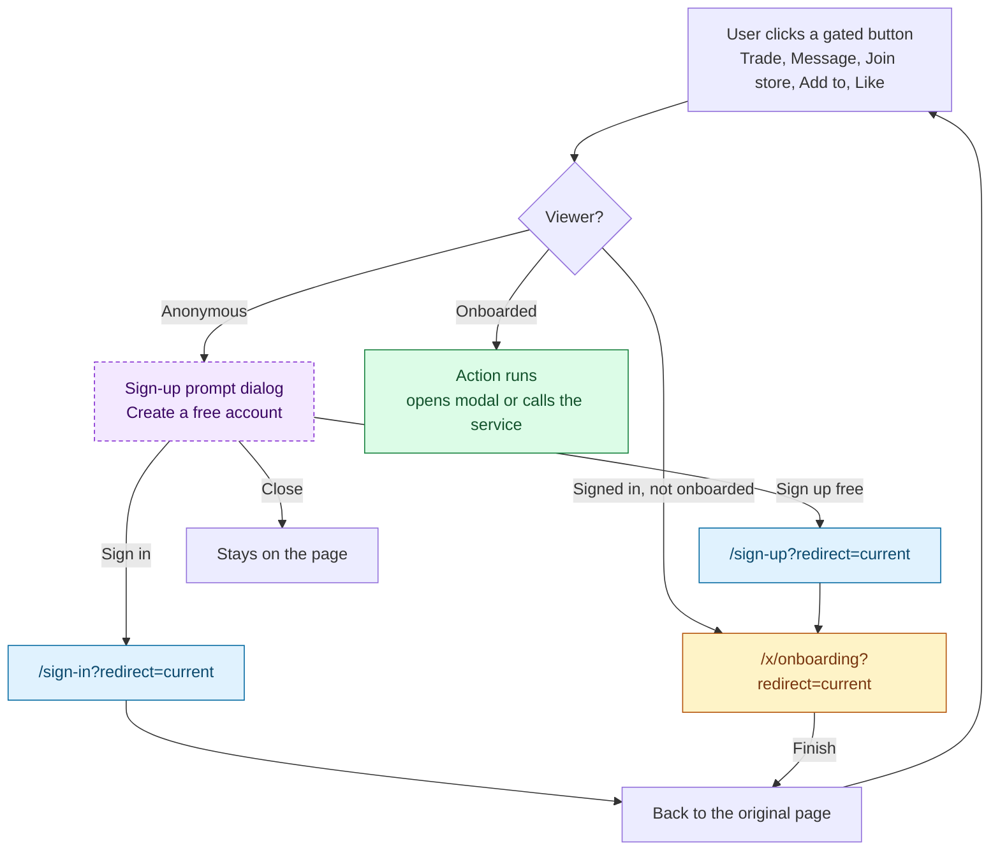
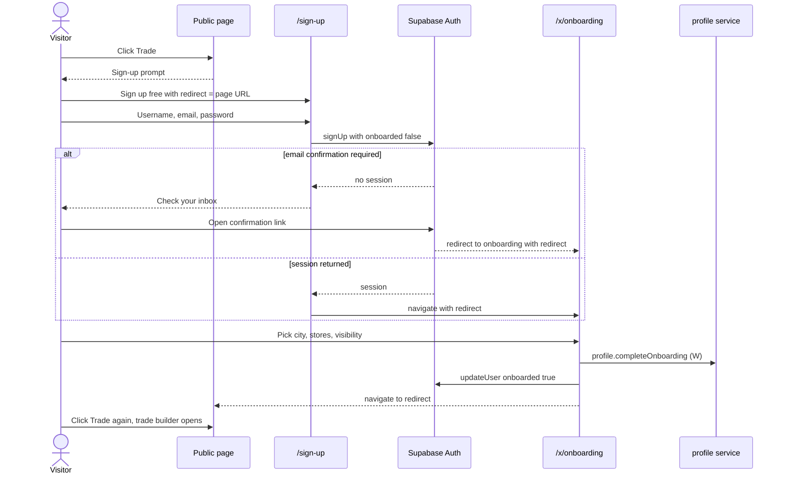
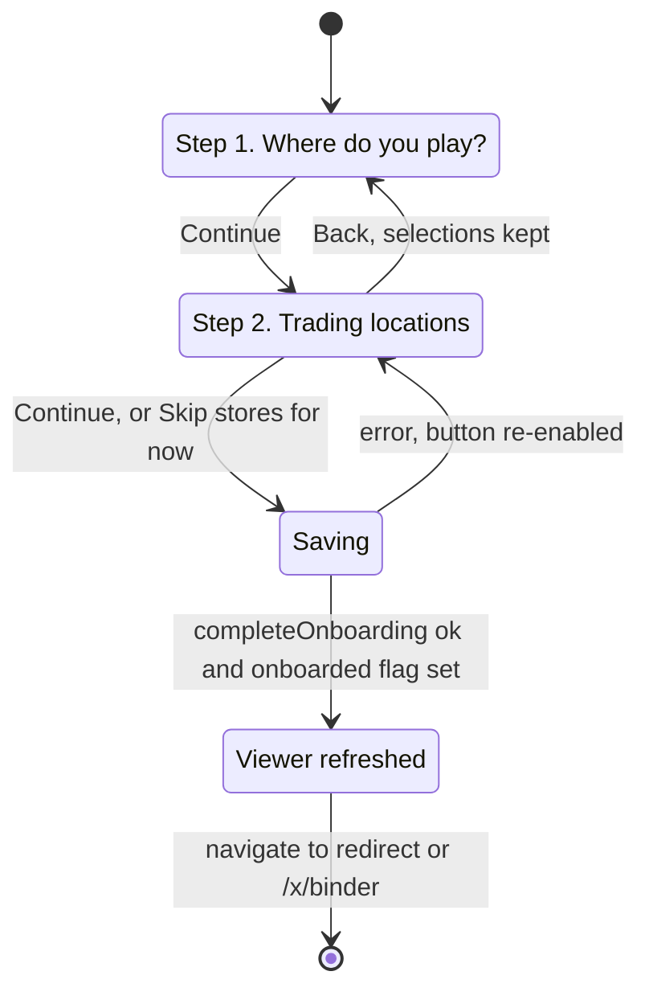

# Access, sign-in and onboarding

How the app decides what a visitor may do, how they get an account, and the first-run setup
that unlocks trading. Read this first: every other page refers to these rules.

## Viewer model

The root route loads the **viewer** once per navigation (`viewerQuery()` → the `fetchViewer`
server function, [`src/routes/__root.tsx`](../../src/routes/__root.tsx),
[`src/auth/viewer.ts`](../../src/auth/viewer.ts)).

| Field | Meaning | Source today |
|---|---|---|
| `kind` | `'anonymous'` or `'user'` | Supabase session cookie, or the dev-only demo cookie `cnm-demo-user` |
| `id`, `username`, `email` | Identity | Supabase user (username in `user_metadata`), or the demo username |
| `onboarded` | Finished first-run setup | Supabase `user_metadata.onboarded`, or demo cookie `cnm-demo-onboarded` equal to the username |
| `demo` | Dev-only demo account | Set when Supabase env vars are missing |

Components read it with `useViewer()`; `/x` pages use `useSignedInViewer()`, which throws
for anonymous viewers.

## Gating primitives

| Primitive | File | What it does |
|---|---|---|
| `SignedIn` / `SignedOut` | [`AuthGate.tsx`](../../src/auth/AuthGate.tsx) | Render children only for that viewer kind. **Ignores onboarding.** |
| `GatedPanel action=…` | `AuthGate.tsx` | Dashed placeholder: lock icon, "Sign up to {action}.", Sign up / Sign in links. Used where a whole block needs an account. |
| `AuthLinks` | `AuthGate.tsx` | "Sign up free" and "Sign in" buttons, both with `?redirect=<current URL>`. |
| `requireAuth(action, run)` | `AuthGate.tsx` (`useRequireAuth`) | For buttons. Anonymous: opens the sign-up prompt. Signed in, not onboarded: goes to `/x/onboarding?redirect=<current URL>`. Onboarded: runs `run()`. |
| `/x` guard | [`src/routes/x/route.tsx`](../../src/routes/x/route.tsx) | Anonymous on any `/x/*`: redirect to `/sign-in?redirect=`. Not onboarded on any `/x/*` except onboarding: redirect to `/x/onboarding?redirect=`. Navigation only; the comment there says every server function must check the session itself. |
| `tradeResultLimit(viewer)` | [`src/auth/limits.ts`](../../src/auth/limits.ts) | 30 for anonymous viewers, no limit otherwise. Applied to city haves and wants. |
| `viewerLimits.tradingStores` | `limits.ts` | 5 joined stores per user. |

### What happens on a gated action

A user who signs in without being onboarded lands back on the original page, and is sent to
onboarding only when they click the gated button again.

### Gated actions and their prompt copy

From `gatedActions` in [`limits.ts`](../../src/auth/limits.ts). The prompt reads
"Sign up to {copy}. You will come straight back to this page."

| Key | Copy | Used by |
|---|---|---|
| `addToCollection` | add cards to your collection or trade lists | Card page "Add to…" |
| `comment` | leave a comment | Deck comments panel |
| `joinStore` | join a store | Store page "Join store" |
| `like` | like decks | Deck **Like** |
| `matches` | see your matches | `/city/$city/matched`, profile matches panel |
| `message` | message other traders | Profile "Message", match card "Message" |
| `ownership` | track which cards you own | Card page ownership panel |
| `priceHistory` | see price history | Card page price chart panel |
| `trade` | start a trade | Every "Trade" button on trade items, profiles and match cards |

## Sign in and sign up

> **Routes** `/sign-in`, `/sign-up` · 🌐 Public · Search: `redirect` (must start with `/` and not `//`)
> **Arrives from** header buttons, `AuthLinks` (sign-up prompt, `GatedPanel`, sign-up promo, 30-result cap banner), "Start trading" and "Get started" CTAs, palette and `G L` / `G R`, the `/x` guard (sign-in only)
> **Leaves to** `redirect` or `/` (sign-in), `/x/onboarding?redirect=…` (sign-up)
> **Loads** `fetchAuthConfig` → `{ supabase, demoAuth }`
> Files: [`sign-in.tsx`](../../src/routes/sign-in.tsx), [`sign-up.tsx`](../../src/routes/sign-up.tsx), [`AuthForm.tsx`](../../src/auth/AuthForm.tsx)

A signed-in viewer who opens either page is redirected to `redirect ?? '/'`.

| Action | UI element | Effect | Backend touchpoint | Gate |
|---|---|---|---|---|
| Continue with Google / Discord / Apple | Provider buttons (Supabase mode only) | OAuth redirect, then back to the destination | Supabase `auth.signInWithOAuth` | 🌐 |
| Sign in with email | Email + Password (min 8), **Sign in** | Signs in, refreshes the viewer, goes to `redirect ?? '/'` | Supabase `auth.signInWithPassword` | 🌐 |
| Create account | Username (`[A-Za-z0-9_-]{2,24}`), Email, Password, **Create account** | Creates the user with `user_metadata { username, onboarded: false }`. With a session: go to onboarding. Without (email confirmation on): shows "Check your inbox…" | Supabase `auth.signUp` | 🌐 |
| Demo sign-in (dev only) | Username only, when Supabase env vars are missing | Sets the httpOnly `cnm-demo-user` cookie | `demoSignIn` server function | 🌐 |
| Switch mode | "No account yet? Sign up" / "Already have an account? Sign in" | Keeps `redirect` | UI only | 🌐 |

Errors show inline under the form.

### Sign-up from a gated action

## Onboarding

> **Route** `/x/onboarding` · 🔑 Signed-in · Search: `redirect`
> **Arrives from** the `/x` guard, sign-up, any `requireAuth` button clicked by a signed-in user who has not onboarded
> **Leaves to** `redirect ?? '/x/binder'`
> **Loads** `places.listCities` (R), `places.detectCity` (R), `profile.get` (R), `places.listStores({ citySlug })` (R)
> File: [`src/routes/x/onboarding.tsx`](../../src/routes/x/onboarding.tsx)

The workspace sub-navigation is hidden on this page. An already onboarded user can still open
it and redo the setup.

| Step | Action | UI element | Effect | Backend touchpoint |
|---|---|---|---|---|
| 1 | Search cities | "Search cities" input | Client-side filter on name and country | UI only |
| 1 | Pick a city | City tiles (traders, "Trading open" / "Unlocking", "near you" for the detected city) | Selects it; picking a different city clears the selected stores | UI only |
| 1 | Continue | Button, disabled without a city | Goes to step 2 | — |
| 2 | Toggle a store | Map pins or checkbox list | Adds or removes it; at 5 the rest are disabled | UI only |
| 2 | Profile visibility | "Show my stores on my profile" switch | Local value | — |
| 2 | Back | Button | Returns to step 1 | — |
| 2 | Finish | "Continue" (1–5 stores) or "Skip stores for now" (0) | Saves, marks the session onboarded, refreshes the viewer, navigates on | `profile.completeOnboarding({ citySlug, storeSlugs, showStoresOnProfile })` (W), then Supabase `auth.updateUser({ data: { onboarded: true } })` or the demo cookie |

**Rules enforced by the mock** (`completeOnboarding` in
[`workspace.ts`](../../src/services/mock/workspace.ts)): the city must exist ("Pick your
city"); store slugs are de-duplicated, at most 5 ("Pick up to 5 stores"); each store must
exist; `onboardedAt` is set only the first time.

## Sign out

Avatar menu → **Sign out**, palette → "Sign out", or `G O`. Demo users clear the cookie,
Supabase users call `auth.signOut()`. The viewer is reloaded and route guards re-run, so a
user on an `/x` page ends up on `/sign-in?redirect=…`. There is no other navigation.

## Gaps / open questions

- **Two sources of truth for onboarding.** Route guards read `user_metadata.onboarded` (or a
  cookie); the profile has its own `onboardedAt`. The two are written in separate calls, and
  if the second fails the user is onboarded in one and not the other. The backend should own
  one flag and expose it on the session.
- **Onboarding does not check that the chosen stores are in the chosen city.**
- **OAuth from sign-in mode skips onboarding.** It lands on `redirect ?? '/'`; onboarding
  only happens at the next gated action or `/x` visit.
- **Some sign-up entry points drop the return path.** "Start trading" (home), "Get started"
  (unlock banner) and `G L` / `G R` link without `redirect`.
- **The `/x` guard sends anonymous visitors to sign-in, not sign-up**, including from the
  "List your cards" / "Import" / "Build a deck" promo cards aimed at new users.
- **`SignedIn` ignores onboarding**, so the matches page and deck comments are available to
  users who never onboarded (see [02](02-discovery-cities-stores.md) and
  [04](04-community-and-content.md)).
- **Account management is missing**: no change of email or password, no account deletion,
  no username change after sign-up.
