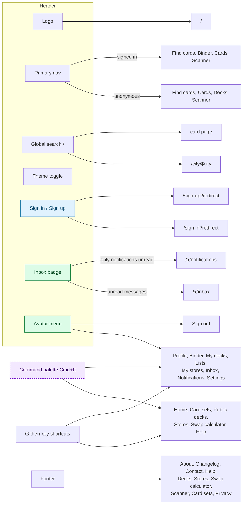
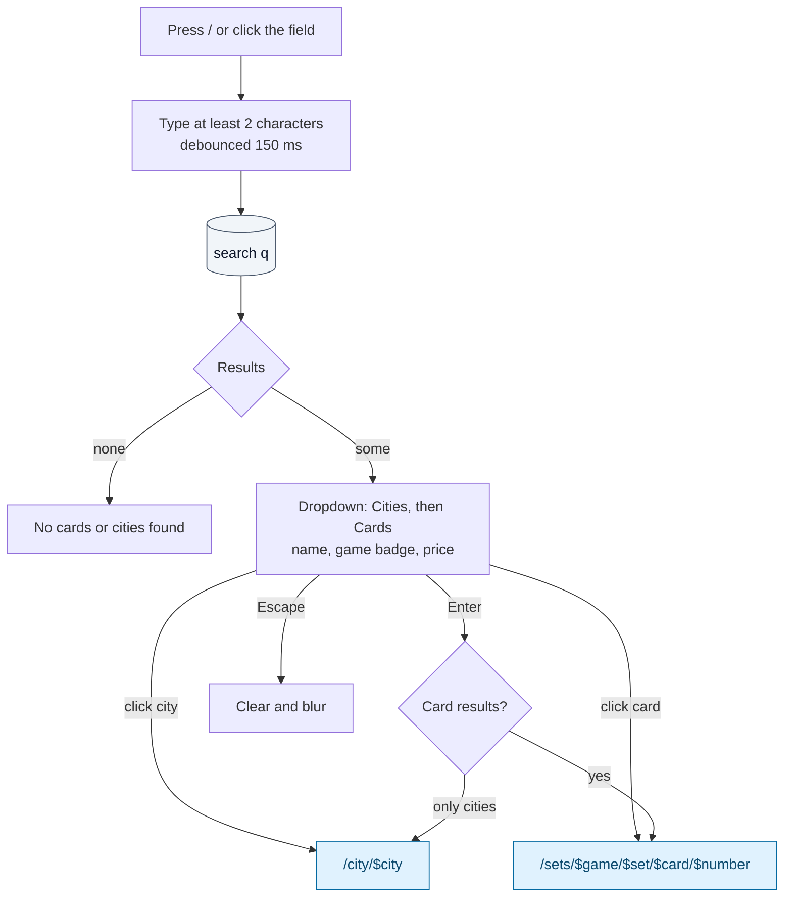

# Global chrome

Everything that sits around the page content on every route: header, user menu, mobile
drawer, global search, command palette, keyboard shortcuts, theme, pricing, footer, toasts and
error pages. Defined in [`src/routes/__root.tsx`](../../src/routes/__root.tsx) and
[`src/components/layout/`](../../src/components/layout/).

Providers wrap every page in this order: Theme › Tooltip › **AuthPrompt** (sign-up prompt) ›
**Pricing** › **TradeBuilder** (trade modal). So the sign-up prompt and the trade builder can
open from any page.

## Navigation map

## Header

> 🌐 Public on every route · File: [`AppHeader.tsx`](../../src/components/layout/AppHeader.tsx), [`navigation.ts`](../../src/components/layout/navigation.ts)

| Item | Anonymous | Signed in | Backend touchpoint |
|---|---|---|---|
| Logo | Link to `/` | Same | — |
| Primary nav | Find cards `/find-cards`, Cards `/sets`, Decks `/decks`, Scanner `/scanner` | Find cards, **Binder** `/x/binder`, Cards, Scanner (public Decks removed) | — |
| Global search | Yes (hidden below `md`) | Yes | `search(q)` (R), see below |
| Theme toggle | Sun / moon icon | Same | UI only (`localStorage['cnm-theme']`, dark by default) |
| Sign in / Sign up | Buttons with `?redirect=<current URL>`; "Sign in" hidden below 640 px | — | — |
| Inbox badge | — | Count of unread messages + unread notifications ("99+" cap). Links to `/x/notifications` when only notifications are unread, otherwise `/x/inbox` | `notifications.getUnreadCounts` (R), polled every 30 s |
| Avatar menu | — | Public profile `/users/$username`, Binder, My decks, Lists, My stores, Inbox, Notifications, Settings, **Sign out** | Sign out: Supabase `auth.signOut` |

### Mobile drawer

Below `lg` a menu button opens a left sheet with the logo, a second global search and the nav list.

| Viewer | Items |
|---|---|
| Anonymous | Find cards, Cards, Decks, Scanner, Stores, Swap calculator, Help |
| Signed in | Find cards, Binder, Cards, Scanner, My decks, Lists, My stores, Inbox, Notifications |

Clicking a nav item closes the drawer.

## Global search

> 🌐 Public · File: [`GlobalSearch.tsx`](../../src/components/layout/GlobalSearch.tsx)
> **Loads** `search(q)` (R): up to 6 cards (`catalogue.searchCards`, one per game and name) and 4 cities (`places.listCities`); `catalogue.listGames` (R) for badges

## Command palette and shortcuts

> 🌐 Public · File: [`CommandPalette.tsx`](../../src/components/layout/CommandPalette.tsx)

**Cmd/Ctrl+K** toggles the palette (even while typing). Selecting an item closes it first.

| Group | Items | Who |
|---|---|---|
| Navigate | Home, Card sets, Public decks, Stores, Swap calculator, Help | Everyone |
| Your space | Binder, My decks, Lists, My stores, Inbox, Notifications | Signed in |
| Account & settings | Switch to light/dark theme, Keyboard shortcuts (`/help/shortcuts`) | Everyone |
| | Sign out | Signed in |
| | Sign in, Sign up (no `redirect`) | Anonymous |

**F1** opens `/help/shortcuts`. **G then a key** (within 1.2 s, not while typing, no modifier):

| Key | Target | Who |
|---|---|---|
| `H` | `/` | Everyone |
| `F` | `/sets` | Everyone |
| `P` | `/decks` | Everyone |
| `S` | `/stores` | Everyone |
| `W` | `/swap-calculator` | Everyone |
| `E` | `/help` | Everyone |
| `L` | `/sign-in` | Anonymous |
| `R` | `/sign-up` | Anonymous |
| `C` | `/x/binder` | Signed in |
| `D` | `/x/decks` | Signed in |
| `T` | `/x/lists` | Signed in |
| `I` | `/x/inbox` | Signed in |
| `N` | `/x/notifications` | Signed in |
| `O` | Sign out | Signed in |

## Pricing source

> File: [`src/lib/pricing.tsx`](../../src/lib/pricing.tsx)

Every `Price` reads a pricing context: **Cardmarket (EUR)** for anonymous and not-onboarded
viewers, otherwise the profile's `pricingSource` (`profile.get` (R)). It is changed only in
[`/x/settings`](09-my-stores-and-settings.md).

## Footer

Same for everyone ([`AppFooter.tsx`](../../src/components/layout/AppFooter.tsx)):

| Column | Links |
|---|---|
| CardNearMe | About, Changelog, Contact |
| Resources | Help centre, Community decks, Stores |
| Tools | Swap calculator, Scanner, Card sets |
| Legal | Privacy |

## Feedback and errors

- **Toasts** (sonner): every workspace write shows a success toast from the page, and a
  failed write shows the service's error message.
- **Error page**: "Something went wrong", the message, **Try again** (re-runs the route).
- **404 page**: "Page not found", **Back home**. Unknown slugs (city, store, set, card, deck,
  user, chat, help topic) all end here.
- **Breadcrumbs** (`PageHeader`): Home icon plus crumbs; the last crumb is plain text.

## Gaps / open questions

- **No locale switcher.** `LocaleSwitcher` exists but is not mounted; copy is English-only.
- **Mobile drawer** has no sign-in, sign-up or sign-out entries, and picking a search result
  inside it does not close it.
- **Signed-in users lose the Decks link** in the header; they reach community decks only
  through the palette, `G P`, the footer or the home page.
- **The shortcuts help article** lists only the public `G` shortcuts.
- **Unread counts are polled** every 30 s. A realtime channel (messages, trade updates,
  notifications) would replace the polling in the header, inbox and chat.
