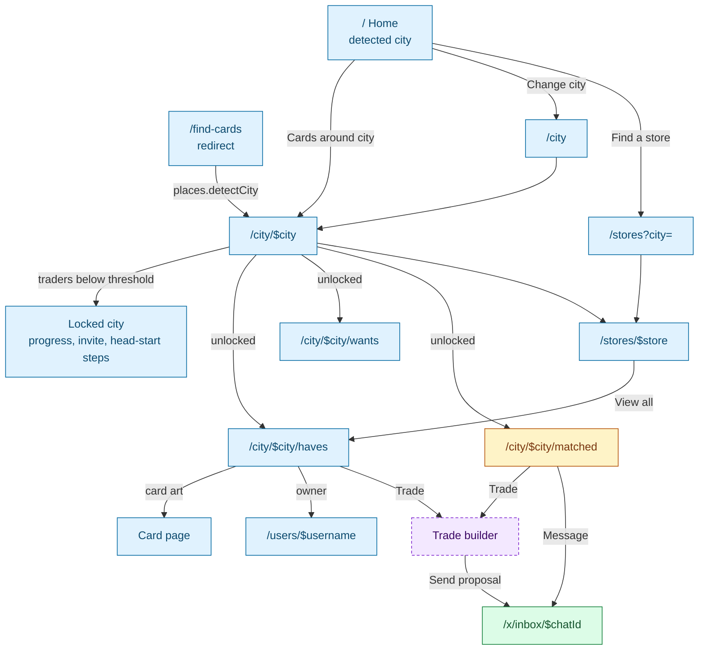
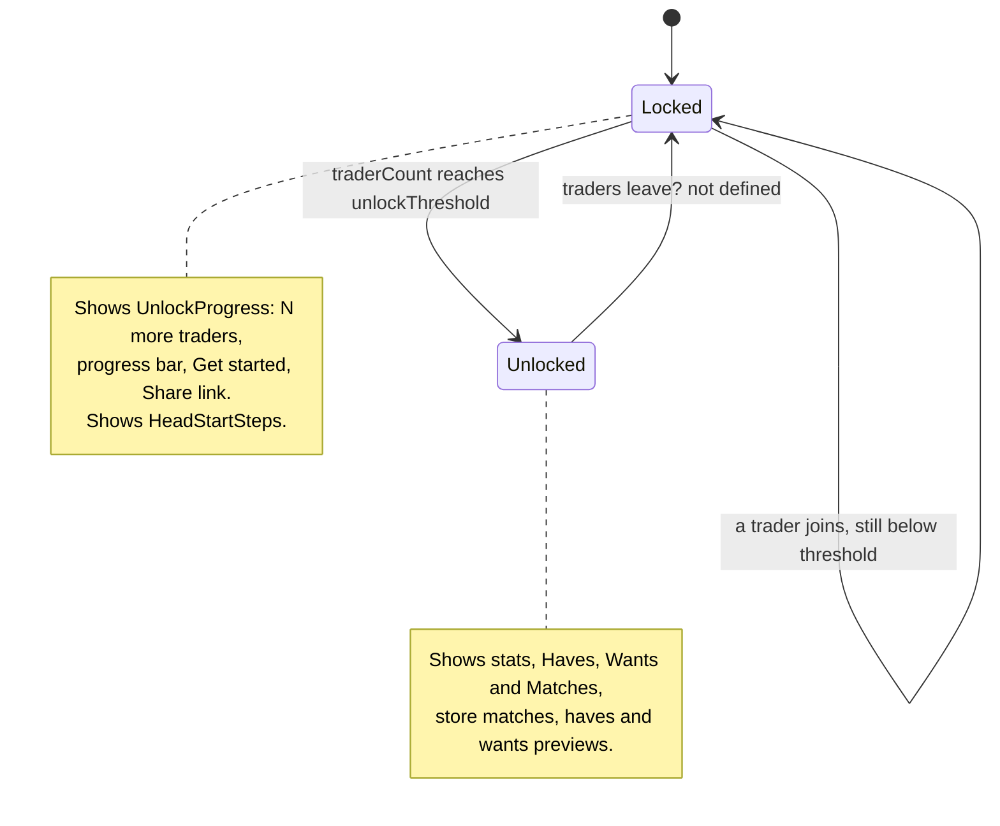
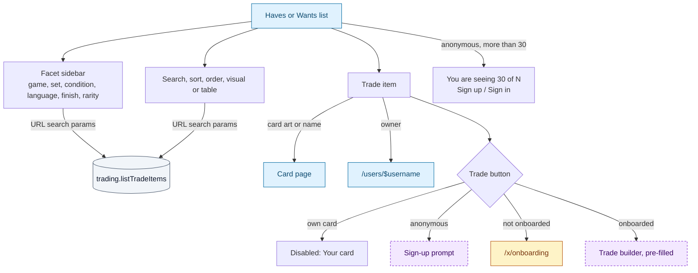
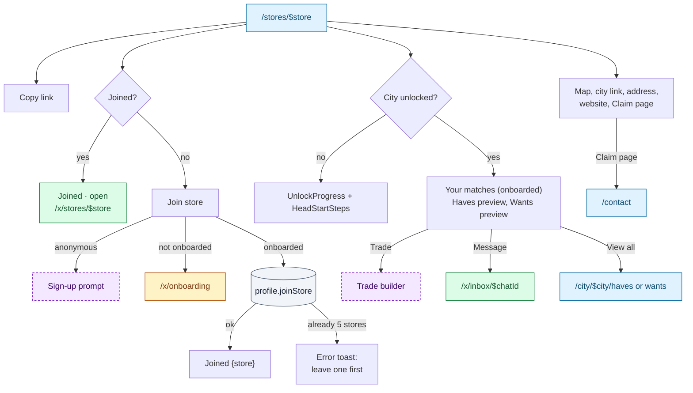

# Discovery: home, cities and stores

How a visitor finds cards to trade near them. Everything is organised by **city** (a trading
hub) and **store** (a local game store where traders meet). City-wide trading only
**unlocks** once a city has enough traders.

## The "find cards near me" journey

## City unlock

A city is **unlocked** when `city.traderCount >= city.unlockThreshold`. Home, the city hub and
the store page switch their content on it. In the mock, Vigevano (1/3, the detected city) and
Madrid (2/3) are locked; Milan, Turin, Rome, Bologna, Sofia and Berlin are unlocked.

## Shared widgets

From [`Promos.tsx`](../../src/components/trading/Promos.tsx) and
[`Places.tsx`](../../src/components/places/Places.tsx).

| Widget | Content and actions | Backend touchpoint |
|---|---|---|
| `UnlockProgress` | "{city} needs N more traders", progress bar, **Get started** → `/sign-up` (no `redirect`, shown to signed-in users too), **Share link** | Share: UI only (clipboard + "Link copied") |
| `HeadStartSteps` | Four cards: Join a store nearby `/stores`, List your cards `/x/lists`, Import your collection `/x/binder/import`, Build a deck `/x/decks` | — (last three go through the `/x` guard) |
| `ShareButton` | Copies the current URL ("Share link", "Copy link", "Invite a trader") | UI only |
| `SignupPromo` | Anonymous only: "Want any of these?", four benefits, `AuthLinks` | — |
| `StoreMap` | Placeholder map; pins show trader count and link to `/stores/$store` (toggle buttons during onboarding) | — |
| `StoreList` | Rows: name, trader count, "Trading hub" badge; link to `/stores/$store` | — |

---

## `/` Home

> 🌐 Public · No params · File: [`src/routes/index.tsx`](../../src/routes/index.tsx)
> **Arrives from** logo, breadcrumbs, 404 page, palette `G H`, default sign-in destination
> **Loads** `places.detectCity` (R), `catalogue.listGames` (R), `places.listStores({ citySlug })` (R), `trading.getCityTradeStats` (R), `community.listDecks({ limit: 4 })` (R), `content.listNews` (R), `content.listFaq` (R)

| Action | UI element | Effect | Backend touchpoint | Gate |
|---|---|---|---|---|
| Open my city | Hero "Cards around {city}" | `/city/$city` | — | 🌐 |
| Find a store | Hero "Find a store" | `/stores` | — | 🌐 |
| Change city | City card "Change city" | `/city` | — | 🌐 |
| Open a nearby store | Store chips (first 5), "+N more" | `/stores/$store`, `/stores?city=` | — | 🌐 |
| Browse city haves / wants | Stat tiles "{n} cards for trade", "{n} cards wanted" (unlocked city only) | `/city/$city/haves`, `/wants` | — | 🌐 |
| Help unlock the city | `UnlockProgress` (locked city only) | Get started → `/sign-up`; Share link | UI only | 🌐 |
| Get a head start | `HeadStartSteps` | `/stores`, `/x/lists`, `/x/binder/import`, `/x/decks` | — | 🌐 / ✅ |
| View trading page | Button, plus Share link | `/city/$city` | UI only | 🌐 |
| See the scanner | Button | `/scanner` | — | 🌐 |
| Open a community deck | 4 deck tiles, "All decks" | Deck detail, `/decks` | — | 🌐 |
| Read market news | Up to 6 items | External link (`#` in the mock) | — | 🌐 |
| Read FAQ | Accordions, "More answers" | `/help/faq` | — | 🌐 |
| Start trading | Final CTA band (anonymous only) | `/sign-up` (no `redirect`) | — | 🌐 |

## `/find-cards`

> 🌐 Public · No UI · File: [`find-cards.tsx`](../../src/routes/find-cards.tsx)
> **Arrives from** header "Find cards", mobile nav, empty inbox "Find traders near you"
> **Loads** `places.detectCity` (R), then redirects to `/city/$city`

## `/city` City index

> 🌐 Public · File: [`city/index.tsx`](../../src/routes/city/index.tsx)
> **Arrives from** home "Change city", "City" breadcrumb · **Loads** `places.listCities` (R)

One card per city (name, country, traders, lock icon if locked) linking to `/city/$city`.

## `/city/$city` City hub

> 🌐 Public · Param `city` (unknown → 404) · File: [`city/$city/index.tsx`](../../src/routes/city/$city/index.tsx)
> **Arrives from** home, global search, `/city`, `/stores` "City trading hub", store page "{city} trading", `/find-cards`
> **Loads** `places.getCity` (R), `places.listStores({ citySlug })` (R), `trading.getCityTradeStats` (R)

| Action | UI element | Effect | Backend touchpoint | Gate |
|---|---|---|---|---|
| Browse haves | Entry card (unlocked) | `/city/$city/haves` | — | 🌐 |
| Browse wants | Entry card (unlocked) | `/city/$city/wants` | — | 🌐 |
| View matches | Entry card (unlocked); copy changes for signed-out viewers | `/city/$city/matched` | — | 🔑 |
| Help unlock | `UnlockProgress`, "What unlocks at N traders?", `HeadStartSteps` (locked) | See shared widgets | UI only | 🌐 |
| Browse stores | "Browse all stores", map pins, store list | `/stores?city=`, `/stores/$store` | — | 🌐 |
| Invite a trader | `ShareButton` | Copies the URL | UI only | 🌐 |

Unlocked header shows Traders, Trades and Stores counts.

## `/city/$city/haves` and `/city/$city/wants`

> 🌐 Public (anonymous capped at 30) · Params `city` · Search `q`, `view` (visual / table), `sort` (updated, name, price, quantity), `order`, `f` (facets)
> **Arrives from** city hub, home stat tiles, store "View all", card page availability (`?q=<card name>`), `/x/stores/$store`
> **Loads** `places.getCity` (R), `trading.listTradeItems({ citySlug, listType, …, limit })` (R)
> Files: [`haves.tsx`](../../src/routes/city/$city/haves.tsx), [`wants.tsx`](../../src/routes/city/$city/wants.tsx), [`TradeBrowser.tsx`](../../src/components/trading/TradeBrowser.tsx), [`TradeItems.tsx`](../../src/components/trading/TradeItems.tsx)

The two pages are identical apart from the list type. Each item is another trader's binder
item: card, condition (minimum for wants), language, finish, quantity, price and owner.

| Action | UI element | Effect | Backend touchpoint | Gate |
|---|---|---|---|---|
| Search | "Search for trades" (250 ms debounce) | Writes `q` | `trading.listTradeItems` (R) | 🌐 |
| Filter | Facet checkboxes, "Clear", "Show all" | Writes `f` | `trading.listTradeItems` (R), facets returned with the page | 🌐 |
| Sort / order / view | Select, order button, view toggle | Writes `sort`, `order`, `view` | `trading.listTradeItems` (R) | 🌐 |
| Open card | Card art or name | Card page | — | 🌐 |
| Open trader | Owner username | `/users/$username` | — | 🌐 |
| Trade | Trade button | Opens the trade builder: for a **haves** item, that card goes into "You get"; for a **wants** item, your copy of the same card goes into "You give" | `trades.getContext(partner)` (R), then see [07-trading.md](07-trading.md) | ✅ |
| Sign up from the cap | Cap banner, `SignupPromo` | `/sign-up?redirect=`, `/sign-in?redirect=` | — | 🌐 |

## `/city/$city/matched`

> 🔑 Signed-in content (page itself public) · Param `city` · File: [`matched.tsx`](../../src/routes/city/$city/matched.tsx)
> **Arrives from** city hub "View matches"
> **Loads** `places.getCity` (R); signed in: `trades.listMatches({ citySlug })` (R), `places.listStores({ citySlug })` (R)

| Action | UI element | Effect | Backend touchpoint | Gate |
|---|---|---|---|---|
| Sign in to see matches | `GatedPanel` (signed out) | `/sign-up` or `/sign-in` with `redirect` | — | 🌐 |
| Open trader | Partner name | `/users/$username` | — | 🔑 |
| Trade with a match | **Trade** on a match card | Trade builder with every match pre-selected (`useMatches`) | `trades.getContext` (R) | 🔑 (should be ✅) |
| Message a match | **Message** | Opens or creates the chat, goes to `/x/inbox/$chatId` | `chat.openChat(partner)` (W) | 🔑 (should be ✅) |
| Find stores | Empty state "Browse stores nearby" | `/stores?city=` | — | 🔑 |

Each match card shows the partner, "Trades at {shared stores}", a match count badge, and
"They have" / "They want" columns (3 cards each, "+N more"). See
[Matching rules](07-trading.md#matching-rules).

## `/stores` Store finder

> 🌐 Public · Search `city` (defaults to the detected city) · File: [`stores/index.tsx`](../../src/routes/stores/index.tsx)
> **Arrives from** home, city hub, matched empty state, `HeadStartSteps`, palette `G S`, footer, `/x/stores` empty state and "Add store"
> **Loads** `places.getCity` or `places.detectCity` (R), `places.listCities` (R), `places.listStores({ citySlug })` (R)

| Action | UI element | Effect | Backend touchpoint | Gate |
|---|---|---|---|---|
| Pick a city | City chips "In which city do you play?" | Writes `?city=` | `places.listStores` (R) | 🌐 |
| Open city hub | "City trading hub →" | `/city/$city` | — | 🌐 |
| Open a store | Store list rows, map pins | `/stores/$store` | — | 🌐 |

## `/stores/$store` Store page

> 🌐 Public · Param `store` (unknown → 404) · File: [`stores/$store.tsx`](../../src/routes/stores/$store.tsx)
> **Arrives from** home store chips, store lists and maps, profile "Trades at", trade card meetup link, `/x/stores/$store` "Public page"
> **Loads** `places.getStore` (R), `places.getCity` (R), `trading.listTradeItems({ storeSlug, listType, limit: 8 })` ×2 (R); onboarded: `trades.listMatches({ storeSlug })` (R), `places.listStores` (R); signed in: `profile.get` (R) for the joined state

| Action | UI element | Effect | Backend touchpoint | Gate |
|---|---|---|---|---|
| Share the store | "Copy link" | Clipboard + toast | UI only | 🌐 |
| Join store | "Join store" | Adds the store to your trading locations; toast "Joined {store}". Sets your city if you had none | `profile.joinStore(slug)` (W). Error at 5 stores: "You can trade at up to 5 stores. Leave one first." | ✅ |
| Open my store view | "Joined · open" | `/x/stores/$store` | — | ✅ |
| Trade / Message a match | "Your matches" section (unlocked, onboarded) | As on the matched page | `trades.getContext` (R), `chat.openChat` (W) | ✅ |
| Trade an item | Trade button on haves / wants previews | Trade builder | `trades.getContext` (R) | ✅ |
| See all haves / wants | "View all {n} →" | City-wide `/city/$city/haves` or `/wants` | — | 🌐 |
| Store info | City link, website (new tab), address | Navigation | — | 🌐 |
| Claim the store | "Is this your store? Claim page →" | `/contact` | — | 🌐 |

## Gaps / open questions

- **Locked cities are reachable by URL.** `/city/$city/haves`, `/wants` and `/matched` never
  check the unlock threshold. Decide whether the backend should refuse trade listings for
  locked cities or whether the lock is only a presentation choice.
- **Matches skip onboarding.** The matched page uses `SignedIn`, and `MatchList` opens the
  trade builder and chat without `requireAuth`. A user with no city or stores can trade from here.
- **"View all" on a store page shows the whole city**, not the store's own listings. The
  trade-item query already accepts `storeSlug`; a store-scoped list page is missing.
- **Store previews are capped at 8 for everyone**, so the 30-result anonymous cap never
  applies on store pages.
- **How is `traderCount` defined?** Users who joined a store in the city, users whose city
  is that city, or users with at least one listing? The unlock rule depends on it. Also
  undefined: whether a city can lock again.
- **City detection** is mocked (always Vigevano). Production needs geo-IP or browser location.
- **Store claiming** goes to the generic contact form; there is no store-owner role.
- **News items** link to `#`; there is no news source yet.
