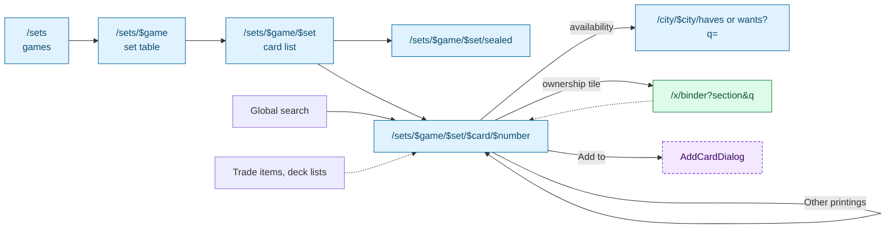
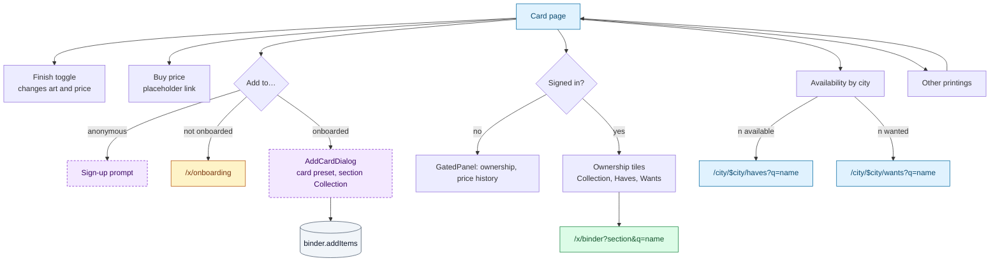

# Catalogue and tools

The card catalogue (games → sets → cards), sealed products, and the two standalone tools:
the swap calculator and the scanner page. The catalogue is public and read-only; the only
writes start from the card page ("Add to…").

## Catalogue drill-down

## `/sets` Games

> 🌐 Public · File: [`sets/index.tsx`](../../src/routes/sets/index.tsx)
> **Arrives from** header "Cards", palette `G F`, footer, breadcrumbs
> **Loads** `catalogue.listGames` (R), `catalogue.listSets(gameId)` (R) per game

One card per game (name, tagline, "{n} sets", "Browse sets") linking to `/sets/$game`.

## `/sets/$game` Set table

> 🌐 Public · Param `game` · Search `q`, `sort` (releasedAt default, name, code, cardCount, marketCap), `order` (default desc) · File: [`sets/$game/index.tsx`](../../src/routes/sets/$game/index.tsx)
> **Loads** `catalogue.getGame` (R), `catalogue.listSets(gameId, { q, sort, order })` (R)

| Action | UI element | Effect | Backend touchpoint | Gate |
|---|---|---|---|---|
| Search sets | "Search a set" (250 ms) | Writes `q` | `catalogue.listSets` (R) | 🌐 |
| Sort / order | Select (Release date, Name, Code, Total cards, Market cap), order button | Writes `sort`, `order` | `catalogue.listSets` (R) | 🌐 |
| Open a set | Set name in the row | `/sets/$game/$set` | — | 🌐 |

## `/sets/$game/$set` Card list

> 🌐 Public · Params `game`, `set` · Search `q`, `view`, `sort` (number default, name, price, priceChange, rarity), `order` (default asc), `f` · File: [`sets/$game/$set/index.tsx`](../../src/routes/sets/$game/$set/index.tsx)
> **Loads** `catalogue.getGame` (R), `catalogue.getSet` (R), `catalogue.listCards({ gameId, setCode, q, sort, order, facets })` (R) → items, total, facets

| Action | UI element | Effect | Backend touchpoint | Gate |
|---|---|---|---|---|
| Sealed products | Button | `/sets/$game/$set/sealed` | — | 🌐 |
| Filter | Facets: Rarity, Types, Finishes, Colors, Artist | Writes `f` | `catalogue.listCards` (R) | 🌐 |
| Search / sort / order / view | `BrowseToolbar` | Writes `q`, `sort`, `order`, `view` | `catalogue.listCards` (R) | 🌐 |
| Open a card | Tile or table row | Card page | — | 🌐 |
| Sign up | `SignupPromo` (anonymous) | Auth pages with `redirect` | — | 🌐 |

## `/sets/$game/$set/sealed`

> 🌐 Public · File: [`sealed.tsx`](../../src/routes/sets/$game/$set/sealed.tsx)
> **Loads** `catalogue.getGame` (R), `catalogue.getSet` (R), `catalogue.listSealed(gameId, setCode)` (R)

Display only: products grouped by category (booster, box, bundle…) with variant and price.
Empty state "No sealed products for this set."

## Card page

> 🌐 Public with gated actions · Route `/sets/$game/$set/$card/$number` (`$card` is a URL slug only; lookup is by game, set and number) · File: [`$number.tsx`](../../src/routes/sets/$game/$set/$card/$number.tsx)
> **Arrives from** global search, set card list, other printings, trade items, deck lists, binder items
> **Loads** `catalogue.getGame` (R), `catalogue.getCard` (R), `catalogue.listPrintings(card)` (R), `catalogue.getCardAvailability(card)` (R); signed in: `binder.getOwnership([cardId])` (R)

| Action | UI element | Effect | Backend touchpoint | Gate |
|---|---|---|---|---|
| Switch finish | Finish toggle (cards with more than one finish) | Changes art and displayed price | UI only | 🌐 |
| Buy | "Buy {price}" | Placeholder (`href="#"`) | — (affiliate link needed) | 🌐 |
| Add to binder | "Add to…" | Opens **AddCardDialog** with the card preset and section Collection. Fields: Add to (Haves / Wants / Collection), List, Printing, Condition, Language, Finish, Quantity. **Add** saves and closes | `lists.list({ type })` (R), `catalogue.listPrintings` (R), `binder.addItems` (W). Details in [05](05-binder-and-lists.md#addcarddialog) | ✅ |
| See my copies | Ownership tiles (counts across all printings with the same name) | `/x/binder?section=<s>&q=<card name>` | `binder.getOwnership` (R) | 🔑 |
| Price history | Sparkline panel | Placeholder only | — (price history service needed) | 🔑 |
| Find it locally | "{n} available" / "{n} wanted" per city | City haves / wants filtered by name | `catalogue.getCardAvailability` (R) | 🌐 |
| Other printings | Card tiles | Other card page | `catalogue.listPrintings` (R) | 🌐 |
| Read legalities and rulings | Display only | — | Part of `catalogue.getCard` | 🌐 |

## `/swap-calculator`

> 🌐 Public · No params · File: [`swap-calculator.tsx`](../../src/routes/swap-calculator.tsx)
> **Arrives from** palette `G W`, mobile nav, footer
> **Loads** `catalogue.searchCards(q, { limit: 8 })` (R) per side as you type

A two-sided value calculator. Nothing is saved.

| Action | UI element | Effect | Backend touchpoint | Gate |
|---|---|---|---|---|
| Set quantity | − / + before adding | Quantity of the next line (min 1) | UI only | 🌐 |
| Add a card | Search (2+ characters, 200 ms) and click a result | Adds a line on "You give" or "You get" | `catalogue.searchCards` (R) | 🌐 |
| Change finish | Select on a line | Non-foil / Foil / Etched; price updates | UI only | 🌐 |
| Remove a line | Trash icon | Removes it | UI only | 🌐 |
| Read the result | Footer | Both totals, the difference and who should add cash | UI only | 🌐 |

## `/scanner`

> 🌐 Public · File: [`scanner.tsx`](../../src/routes/scanner.tsx) · **Loads** `catalogue.listGames` (R)

Marketing page for the mobile scanner. Shows badges for games with the `scanner` capability.
The only control is a disabled "Mobile app coming soon" button.

## Gaps / open questions

- **Card data and prices have no source yet.** `catalogue.*` needs a card database per game
  (sets, printings, finishes, legalities, rulings, images) and a price feed per pricing
  source (Cardmarket EUR, TCGplayer USD). The mock has one price per finish, so switching to
  USD only changes the symbol.
- **Price history** (card page sparkline) and the **Buy** link are placeholders.
- **Card identity across printings** is "same game + same name" (ownership, matching,
  availability). Confirm this is the intended rule before modelling it in the database.
- **The card page "Add to…" ignores the finish toggle** and always starts on the printing's
  first finish.
