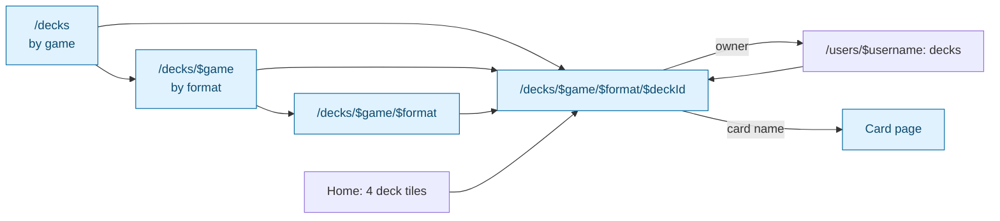
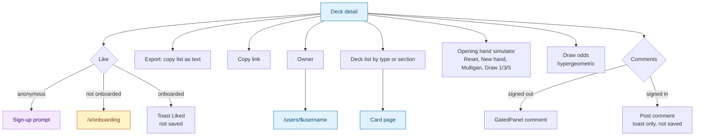
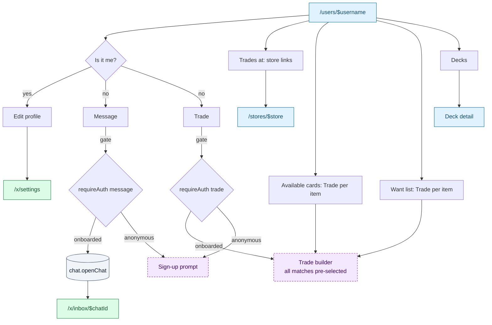

# Community and content

Community decks, public trader profiles, the help centre and the static pages. All of it is
public; the gated actions are deck likes and comments, and messaging or trading with a
trader from their profile.

## Community decks

Only games with the `deckBuilder` capability appear (MTG, Riftbound, One Piece in the mock).
A deck tile shows game, format, name, owner, likes and comment count.

### `/decks`

> 🌐 Public · File: [`decks/index.tsx`](../../src/routes/decks/index.tsx)
> **Arrives from** header "Decks" (anonymous only), palette `G P`, footer, home "All decks"
> **Loads** `catalogue.listGames` (R), `community.listDecks()` (R)

Game tiles → `/decks/$game`; per game up to 5 deck tiles and "View all" → `/decks/$game`.

### `/decks/$game`

> 🌐 Public · Param `game` · File: [`decks/$game/index.tsx`](../../src/routes/decks/$game/index.tsx)
> **Loads** `catalogue.getGame` (R), `community.listDecks({ gameId })` (R)

One section per format with up to 5 deck tiles and "View all" → `/decks/$game/<format>`.

### `/decks/$game/$format`

> 🌐 Public · Params `game`, `format` (case-insensitive; unknown → 404) · File: [`decks/$game/$format/index.tsx`](../../src/routes/decks/$game/$format/index.tsx)
> **Loads** `catalogue.getGame` (R), `community.listDecks({ gameId, format })` (R)

A grid of deck tiles linking to deck detail.

### Deck detail

> 🌐 Public with gated actions · Route `/decks/$game/$format/$deckId` · File: [`$deckId.tsx`](../../src/routes/decks/$game/$format/$deckId.tsx), tools in [`DeckTools.tsx`](../../src/components/decks/DeckTools.tsx), maths in [`deckMath.ts`](../../src/lib/deckMath.ts)
> **Loads** `catalogue.getGame` (R), `community.getDeck` (R), `community.listDeckComments` (R)

| Action | UI element | Effect | Backend touchpoint | Gate |
|---|---|---|---|---|
| Like | Heart button with count | Toast "Liked" | **UI only** (needs `community.likeDeck`) | ✅ |
| Export | "Export" | Copies `// Section` + `qty name` lines | UI only | 🌐 |
| Copy link | "Copy link" | Copies the URL | UI only | 🌐 |
| Open owner | Owner name | `/users/$username` | — | 🌐 |
| Open a card | Card name in the list | Card page | — | 🌐 |
| Simulate a hand | Reset, New hand, Mulligan (n), Draw 1 / 3 / 5, click a card to remove it | Shows hand, lands, remaining, hand value, keep / mulligan verdict | Client-side (`deckMath.ts`) | 🌐 |
| Calculate draw odds | Copies in deck, Cards drawn, Copies, At least / Exactly / At most | Probability and distribution chart | Client-side | 🌐 |
| Post a comment | Textarea + "Post comment" | Toast "Comment posted", field cleared | **UI only** (needs `community.addDeckComment`) | 🔑 |
| Read comments | List | Display | `community.listDeckComments` (R) | 🌐 |

Stats panels (total value, mana curve, card types) are display only. Anonymous visitors see
"Sign in to see which cards you own." as plain text; owned counts are not shown here yet.

## `/users/$username` Public profile

> 🌐 Public with gated actions · Param `username` (unknown → 404) · File: [`users/$username.tsx`](../../src/routes/users/$username.tsx)
> **Arrives from** avatar menu "Public profile", trade item owners, match cards, deck owner, chat header, match notifications, binder "Share" link
> **Loads** `community.getUser` (R), `catalogue.listGames` (R), `places.listCities` (R), `places.listStores` (R), `community.listDecks({ ownerUsername, limit: 4 })` (R), `trading.listTradeItems({ ownerUsername, listType, limit: 10 })` ×2 (R)

| Action | UI element | Effect | Backend touchpoint | Gate |
|---|---|---|---|---|
| Edit my profile | "Edit profile" (own profile) | `/x/settings` | — | 🔑 |
| Message | "Message" | Opens or creates the conversation | `chat.openChat(username)` (W) | ✅ |
| Trade | "Trade" | Trade builder with every match pre-selected | `trades.getContext(username)` (R) | ✅ |
| Trade one card | Trade button on an available or wanted card | Trade builder pre-filled with that card | `trades.getContext` (R) | ✅ |
| Open a store | "Trades at" links | `/stores/$store` | — | 🌐 |
| Open a deck | Deck tiles | Deck detail | — | 🌐 |
| See matches | `GatedPanel` (anonymous): "See what you can trade with {username}" | Auth links | — | 🌐 |

The aside shows completed trades, decks, haves and wants counts, cities, member-since year,
games and meeting places. Haves and wants show only the first 10, with no "View all".

## Help centre

> 🌐 Public · Routes `/help`, `/help/$topic` · Files: [`help/route.tsx`](../../src/routes/help/route.tsx), [`help/index.tsx`](../../src/routes/help/index.tsx), [`help/$topic.tsx`](../../src/routes/help/$topic.tsx)
> **Arrives from** palette `G E`, F1 (`/help/shortcuts`), footer, home "More answers" (`/help/faq`)
> **Loads** `content.listHelpArticles` (R), `content.getHelpArticle(slug)` (R), `content.listFaq` (R) for the `faq` topic

Topics: getting-started, faq, scanner, collection, trading, decks, search, stores, account,
shortcuts. The sidebar links every topic and "Contact support" (`/contact`). The index has
"Start here" cards. A topic page shows its sections; `faq` shows accordions.

## Static pages

| Route | Content | Actions | Backend touchpoint |
|---|---|---|---|
| `/changelog` | Release timeline (New, Improvements, Fixes) | None | `content.listChangelog` (R) |
| `/about` | About text | "Get in touch" → `/contact` | — |
| `/contact` | Form: Name, Email, Message (all required) | **Send message**: toast "Message sent", form replaced by a thank-you note | **UI only** (needs a contact endpoint) |
| `/privacy` | Placeholder policy | None | — |

`/contact` is also the target of "Contact support" (help) and "Claim page" (store page).

## Gaps / open questions

- **Deck likes and comments are not saved.** `CommunityService` has `listDeckComments` but no
  write methods.
- **Comments need only sign-in, likes need onboarding.** Pick one rule.
- **Your own decks are missing from the community pages.** Decks built in
  [`/x/decks`](06-deck-builder.md) have a public/private flag, but `community.listDecks`
  reads only seed data.
- **Profiles do not reflect the workspace.** The public profile reads seeded trade items;
  your binder, list visibility and `showStoresOnProfile` are not applied. The backend must
  decide what a profile exposes: public lists only, stores only if allowed.
- **Contact form** has no endpoint; store claims go through it too.
- **No users index** (`/users` breadcrumb is plain text).
