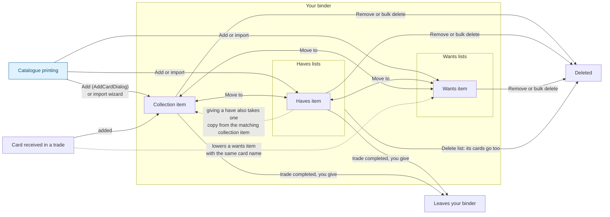
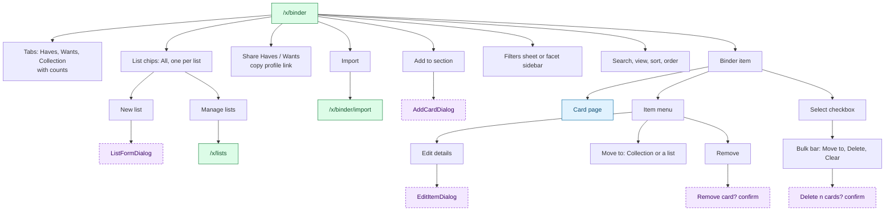
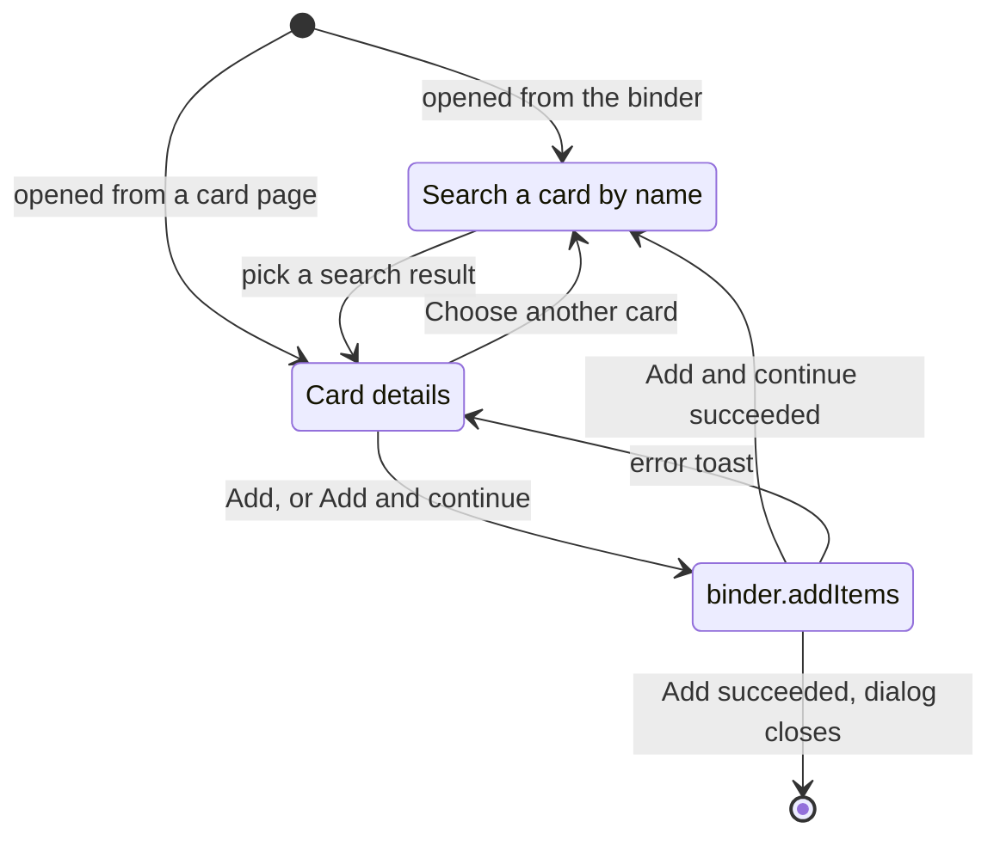
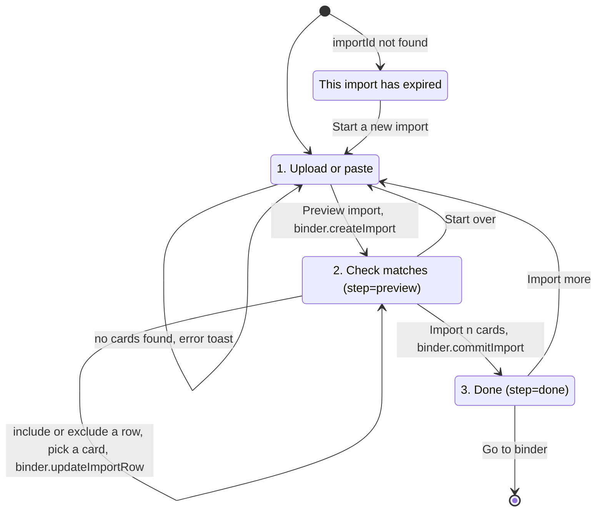

# Binder and trade lists

The signed-in user's cards. The **binder** has three sections:

- **Collection**: cards you own.
- **Haves**: cards you offer, each on a haves **list**.
- **Wants**: cards you look for, each on a wants **list**. The condition is the minimum you accept.

Haves and wants feed matching and trading ([07-trading.md](07-trading.md)). All pages here
are ✅ Onboarded (behind the `/x` guard) and every write goes through `binder.*` or `lists.*`.

## Card placement model

Where a card can live, and every action that moves it. This is the core of the binder data model.

Rules behind the diagram (mock: [`workspace.ts`](../../src/services/mock/workspace.ts)):

- An item is a printing plus **condition, finish, language** and **quantity** (1–999).
  Adding an item identical to an existing one (same section, list, card, finish, condition,
  language) **adds to its quantity**.
- **Collection and haves are separate records.** A collection item is shown as **Listed**
  when the same printing is also on a haves list. Listing a card on haves does not take it out
  of the collection; **moving** it does.
- **In trade**: an item offered in a pending or accepted trade. It is only a badge and a
  filter; it does not block editing, moving, removing or offering it again.
- **List resolution** (add, move, edit, import): haves and wants items must sit on a list of
  the same type; a list restricted to a game only accepts that game. With no list given, the
  first compatible list is used, and if there is none a public "My haves" / "My wants" list is
  created automatically.

---

## `/x/binder`

> ✅ Onboarded · Search `section` (haves default, wants, collection), `list`, `q`, `view`, `sort` (updated default, name, price, quantity), `order` (desc default), `f` · File: [`x/binder/index.tsx`](../../src/routes/x/binder/index.tsx), items in [`BinderItems.tsx`](../../src/components/binder/BinderItems.tsx)
> **Arrives from** header "Binder", workspace nav, palette `G C`, `/x`, end of onboarding, list names on `/x/lists`, card page ownership tiles (`?section&q`), import "Go to binder"
> **Loads** `binder.getCounts` (R), `binder.listItems({ section, listId, q, sort, order, facets })` (R) → items, facets, stats; `lists.list()` (R)

| Action | UI element | Effect | Backend touchpoint |
|---|---|---|---|
| Switch section | Tabs Haves / Wants / Collection (total quantity each) | `?section=`; resets list, filters, sort, view and selection | `binder.listItems` (R), `binder.getCounts` (R) |
| Read stats | Market value, Cards (total quantity), Distinct printings | Computed over the section and list, before search and filters | Part of `binder.listItems` |
| Pick a list | Chips "All {section}", one per list with card count (haves / wants only) | `?list=` | `binder.listItems` (R) |
| Create a list | "New list" chip | ListFormDialog; afterwards the new list is selected | `lists.create` (W) |
| Manage lists | "Manage lists" | `/x/lists` | — |
| Share | "Share Haves" / "Share Wants" | Copies `/users/<username>`; toast | UI only |
| Import | "Import" | `/x/binder/import?section=&list=` | — |
| Add a card | "Add to {section}", or "Add a card" in the empty state | AddCardDialog with this section and list preselected | see [AddCardDialog](#addcarddialog) |
| Filter | Filters sheet (haves / wants), facet sidebar (collection) | Writes `f`. Haves/wants: game, set, condition, language, finish, rarity. Collection also: trade status, list status, types, artist | `binder.listItems` (R) |
| Search / sort / view | Toolbar | Writes `q` (card or set name), `sort`, `order`, `view` | `binder.listItems` (R) |
| Open the card | Card art or name | Card page | — |
| Edit an item | Item menu → "Edit details" | EditItemDialog | `binder.updateItem` (W) |
| Move an item | Item menu → "Move to" (Collection or any compatible list, not the current one) | Toast "Moved {card} to {target}" | `binder.moveItems([id], { section, listId })` (W) |
| Remove an item | Item menu → "Remove" → "Remove {card}?" ("It is removed" / "All {n} copies are removed from your binder") → Remove | Toast "Removed {card}" | `binder.removeItems([id])` (W) |
| Select items | Checkbox per item | Shows the bulk bar "{n} selected" | UI only |
| Bulk move | Bulk bar "Move to…" (Collection or any list that accepts every selected card, not the one they are all already in; "No list fits every selected card" when none) | Toast "Moved {n} cards to {target}" | `binder.moveItems(ids, target)` (W); one incompatible card would reject the whole move |
| Bulk delete | Bulk bar "Delete" → "Delete {n} cards?" → Delete | Toast "Cards deleted" | `binder.removeItems(ids)` (W) |

Each item shows card art, set, list name, condition, language, finish, quantity, price,
updated time, and the **Listed** and **In trade** badges.

### AddCardDialog

> Opened from the binder ("Add to…", empty state) and the card page ("Add to…", card preset) · File: [`AddCardDialog.tsx`](../../src/components/binder/AddCardDialog.tsx)

| Step | Field or action | Rules | Backend touchpoint |
|---|---|---|---|
| Search | "Search a card by name" (2+ characters, 200 ms) | Results: art, name, set, price | `catalogue.searchCards` (R) |
| Details | **Add to**: Haves / Wants / Collection | Defaults to the page's section | — |
| | **List** (haves / wants) | Lists of that type that accept the card's game; default is the page's list or the first one. With none, the option "New "My {section}" list" sends `listId: null` | `lists.list({ type })` (R) |
| | **Printing** | The card plus other printings with the same name; resets an unsupported finish | `catalogue.listPrintings` (R) |
| | **Condition** (NM), "Minimum condition" for wants · **Language** (en) · **Finish** (printing's finishes) · **Quantity** (1–999) | Market price shown for the chosen finish | — |
| | **Add** / **Add and continue** (not when preset) | Toast "Added {q}× {name} to {list or collection}" | `binder.addItems([item])` (W) |

### EditItemDialog

Opened from the item menu. Fields: Condition (minimum for wants), Language, Finish (only
those this printing has), Quantity (1–999), List (haves / wants, compatible lists of the same
type). **Save** → `binder.updateItem(id, patch)` (W), toast "Card updated". The card, printing
and section cannot change here; use Move.

### ListFormDialog

> Opened from binder "New list", `/x/lists` "Add list" and "Rename / edit" · File: [`ListFormDialog.tsx`](../../src/components/binder/ListFormDialog.tsx)

| Field | Rules |
|---|---|
| Name | Required, max 60 |
| Type | Haves / Wants; **create only**, cannot change later |
| Game | "Any game" or one game; cannot be restricted if the list already has cards from another game |
| Visibility | Public (default) / Private |

Create → `lists.create(input)` (W), toast "Created {name}". Edit → `lists.update(id, input)` (W), toast "List updated".

---

## `/x/lists`

> ✅ Onboarded · Search `q`, `sort` (updated default, created, name), `order` (desc default) · File: [`x/lists.tsx`](../../src/routes/x/lists.tsx)
> **Arrives from** workspace nav, palette `G T`, binder "Manage lists", `HeadStartSteps` "List your cards"
> **Loads** `lists.list({ q, sort, order })` (R), `catalogue.listGames` (R)

| Action | UI element | Effect | Backend touchpoint |
|---|---|---|---|
| Add a list | "Add list" | ListFormDialog (create) | `lists.create` (W) |
| Search / sort / order | Search (250 ms), select, order button | Writes `q`, `sort`, `order` | `lists.list` (R) |
| Open a list | List name | `/x/binder?list=<id>&section=<type>` | — |
| Rename or edit | Row menu → "Rename / edit" | ListFormDialog (edit) | `lists.update` (W) |
| Change visibility | Row menu → "Make private" / "Make public" | Toast "{name} is now {visibility}" | `lists.update(id, { visibility })` (W) |
| Delete | Row menu → "Delete" → "Delete {name}?" ("The list and its {n} cards are removed") → Delete list | Toast "Deleted {name}" | `lists.remove(id)` (W), **cascades to its items** |

Columns: List, Type, Game (or "Any"), Cards (total quantity), Visibility, Updated, Actions.

---

## `/x/binder/import` Import wizard

> ✅ Onboarded · Search `section`, `list`, `step` (preview, done), `importId` · File: [`x/binder/import.tsx`](../../src/routes/x/binder/import.tsx), parsers in [`cardListText.ts`](../../src/lib/cardListText.ts)
> **Arrives from** binder "Import", `HeadStartSteps` "Import your collection", "Import more", "Start over"
> **Loads** `lists.list()` (R); with `importId`: `binder.getImport(importId)` (R)

The steps are a real sequence: the import draft lives on the server between steps, and its id
is in the URL, so a reload keeps the preview.

| Step | Action | UI element | Effect | Backend touchpoint |
|---|---|---|---|---|
| 1 | Choose source | "Paste a list" / "CSV" | Changes help text; CSV adds a file picker | UI only |
| 1 | Load a CSV | File picker (`.csv`, text) | Reads the file into the textarea | UI only |
| 1 | Choose destination | "Import into" Collection / Haves / Wants, **List** (all lists of that type) | Defaults from the URL | — |
| 1 | Preview import | Button | Parses in the browser; skipped lines listed ("Line N: …"). 0 rows → "No cards found in this list". Otherwise creates the draft and goes to step 2 | `binder.createImport({ section, listId, source, rows })` (W) |
| 2 | Include / exclude a row | Checkbox (disabled when unmatched) | Updates the row | `binder.updateImportRow(id, line, { include })` (W) |
| 2 | Match a row by hand | "No match — pick the card" + card search | Sets the card and includes the row | `binder.updateImportRow(id, line, { cardId })` (W), `catalogue.searchCards` (R) |
| 2 | Start over | Link | Back to step 1 with the same section | — |
| 2 | Confirm | "Import {n} cards into {destination}" | Adds the rows to the binder | `binder.commitImport(id)` (W) |
| 3 | Go on | "Go to binder" / "Import more" | Navigation | — |

The summary bar shows cards to import, matched lines and lines that still need a match.

**Accepted formats.**

- **Text**: one card per line, `[qty[x]] Name [(SET) number] [*F*|*E*]`. Lines starting with
  `//` or `#` and deck section headers are ignored.
- **CSV**: header row required; `,` or `;` delimiter; quoted fields. Column names recognised:
  name (`name`, `card`, `card name`), set (`set`, `set code`, `edition`, `expansion`),
  number (`number`, `collector number`, `cn`, `no`), quantity (`quantity`, `qty`, `count`,
  `amount`), finish (`finish`, `foil`, `printing`), condition (`condition`, `cond`),
  language (`language`, `lang`). No name column → "The CSV needs a "Name" column".

**Server-side matching** (`createImport`): exact set + number → name within the set → name
within the user's games → any name → no match. At most 1000 rows. Commit fills defaults
(NM, en, non-foil if the finish is missing) and merges like a normal add.

## Gaps / open questions

- **The import list picker ignores game restrictions**, so a mismatch only fails at commit,
  and commit is **not atomic**: rows before the failing one are already added.
- **Import drafts never expire** in the mock; "expired" only appears when the id is unknown.
  Decide a retention policy.
- **In-trade items are not reserved.** They can be moved, removed or offered in another trade.
  Decide whether a pending or accepted trade should lock the quantities it uses.
- **List visibility has no effect yet.** Public pages read seed data; private lists would
  still need to be hidden from profiles, city lists, matches and store previews.
- **Haves vs collection duplication.** Listing a card on haves creates a second record; the
  backend could instead model haves as "a quantity of a collection item offered on a list".
  Worth deciding before the schema.
- **Selection survives list and filter changes**, including items no longer visible.
