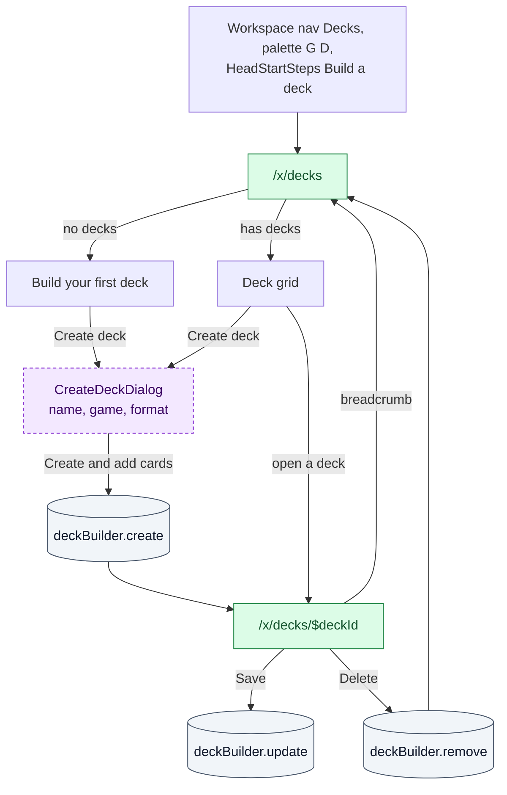
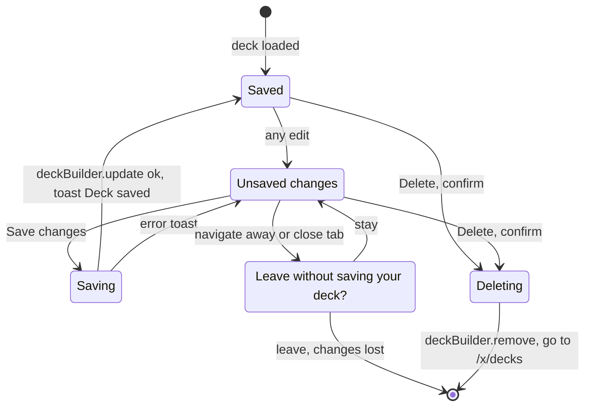

# Deck builder

Your own decks: create, edit, validate and share deck lists. Both pages are ✅ Onboarded and
write through `deckBuilder.*`. Public decks of other players are in
[04-community-and-content.md](04-community-and-content.md).

## From "My decks" to the builder

## `/x/decks`

> ✅ Onboarded · No params · File: [`x/decks/index.tsx`](../../src/routes/x/decks/index.tsx)
> **Arrives from** workspace nav, avatar menu, palette `G D`, `HeadStartSteps`, builder breadcrumb, after deleting a deck
> **Loads** `deckBuilder.listMine` (R), sorted by last update

| Action | UI element | Effect | Backend touchpoint |
|---|---|---|---|
| Create a deck | "Create deck" (header when decks exist, or empty state) | CreateDeckDialog | — |
| Open a deck | Deck card (game, format, private icon, name, "{n} cards · updated …") | `/x/decks/$deckId` | — |

**CreateDeckDialog.** Name (required, max 80), Game (only games with the deck builder
capability; default MTG), Format (that game's formats). **Create and add cards** →
`deckBuilder.create({ name, gameId, format, description: '', visibility: 'private', cards: [] })` (W),
then opens the builder. New decks are always private.

## `/x/decks/$deckId` Builder

> ✅ Onboarded · Param `deckId` (unknown → 404) · File: [`x/decks/$deckId.tsx`](../../src/routes/x/decks/$deckId.tsx), validation in [`deckValidation.ts`](../../src/lib/deckValidation.ts), text format in [`cardListText.ts`](../../src/lib/cardListText.ts)
> **Loads** `deckBuilder.getMine(deckId)` (R), `catalogue.listGames` (R), `binder.getOwnership(cardIds)` (R) for owned counts, `catalogue.searchCards` (R) while adding

Everything is edited in a **local draft** and saved in one call.

| Action | UI element | Effect | Backend touchpoint |
|---|---|---|---|
| Rename | Inline title input (max 80) | Draft | — |
| Change format | Format select | Draft; validation re-runs | — |
| Change visibility | Private / Public select | Draft | — |
| Add a card | Card search (this game only) + "Add to" toggle: Commander (Commander format only), Main deck, Sideboard, Considering | +1 copy in that section (or +1 to an existing entry) | `catalogue.searchCards({ gameId })` (R) |
| Change quantity | Stepper per row (1–99) | Draft | — |
| Move a card | Row menu "Move to {section}" | Draft | — |
| Remove a card | ✕ on the row | Draft | — |
| See owned copies | "Own N" pill per row (green when you own enough) | Counts your **collection**, any printing with the same name | `binder.getOwnership(cardIds)` (R) |
| Edit description | Textarea (max 2000) | Draft | — |
| Export | "Import / export" → Export → Copy | Copies the list (`Commander`, `Deck`, `Sideboard`, `Maybeboard` headers, `qty Name (SET) number`) | UI only |
| Import | "Import / export" → paste → Import | **Replaces** the draft's cards; toast "Imported {n} cards ({m} not found)" | `catalogue.searchCards(name, { gameId, limit: 20 })` (R) per line |
| Save | "Save changes" (enabled when dirty) | Toast "Deck saved" | `deckBuilder.update(id, input)` (W) |
| Delete | "Delete" → "Delete {name}?" ("Your cards stay in your binder") → Delete deck | Toast "Deck deleted", go to `/x/decks` | `deckBuilder.remove(id)` (W) |

The sidebar shows the **legality** panel (up to 12 issues), the **mana curve** (MTG) and the
**card types** breakdown. The summary line shows main and side counts and the deck value.

### Validation rules (client-side, do not block saving)

| Rule | MTG Commander | Other formats |
|---|---|---|
| Commander | 1 or 2 required | — |
| Deck size | Commander + main deck = exactly 100 | Minimum main deck: MTG 60, Lorcana 60, FaB 60, One Piece 50, Fusion World 50, SWU 50, Riftbound 40 |
| Sideboard | — | At most 15 |
| Copies per card name | 1 (except basic lands) | MTG, Lorcana, One Piece, Fusion World 4; FaB, SWU, Riftbound 3 (except basic lands) |
| Card legality in format | banned or not legal → error; restricted with more than 1 copy → error; no data (MTG) → warning | same |

"Considering" cards never count.

## Gaps / open questions

- **No server-side validation.** The mock checks names, sizes (max 500 entries, quantity
  1–999) and card existence, but not the format, the game's deck-builder capability or
  legality. Decide whether illegal decks can be saved (today: yes) and whether public decks
  must be legal.
- **Public decks are not published.** Setting a deck to public has no effect on
  `/decks/**`; the community service needs to read workspace decks.
- **Import resolves cards in the browser**, one search call per line. A server-side
  "resolve card list" endpoint (shared with the binder import) would be faster and consistent.
- **Switching away from Commander** hides the Commander section but keeps its cards in the
  draft and counts them in the main deck.
- **The game cannot change after creation.**
- **Owned counts use only the collection section.** Cards you have on a haves list but not
  in the collection show as not owned.
