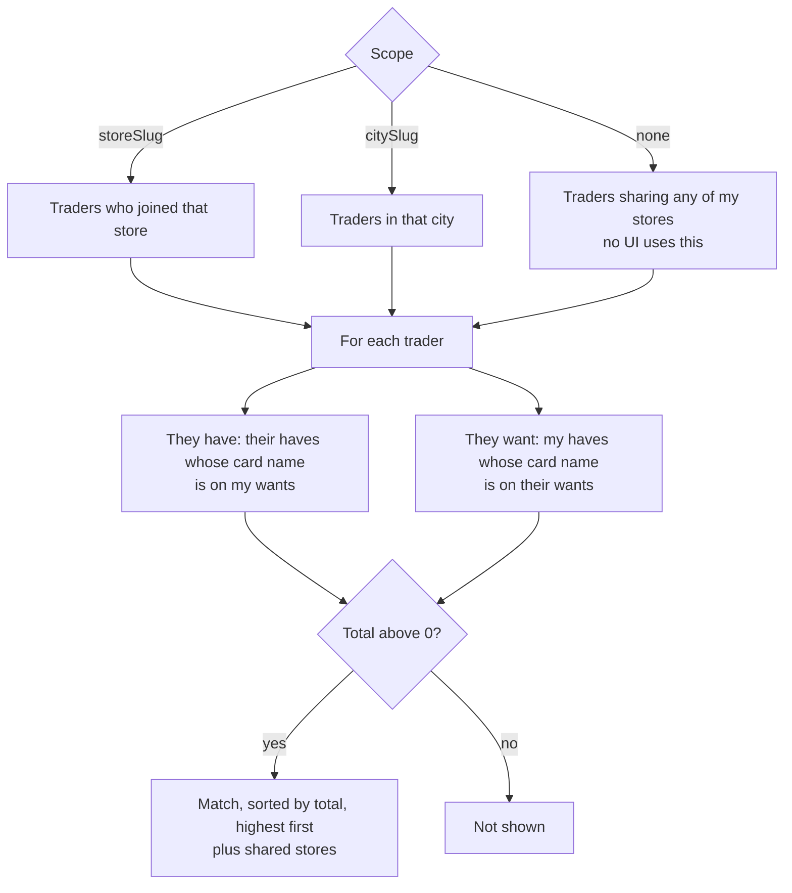
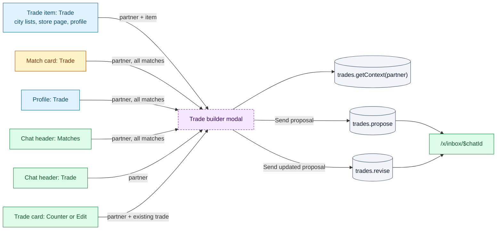
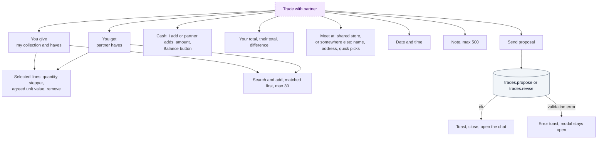
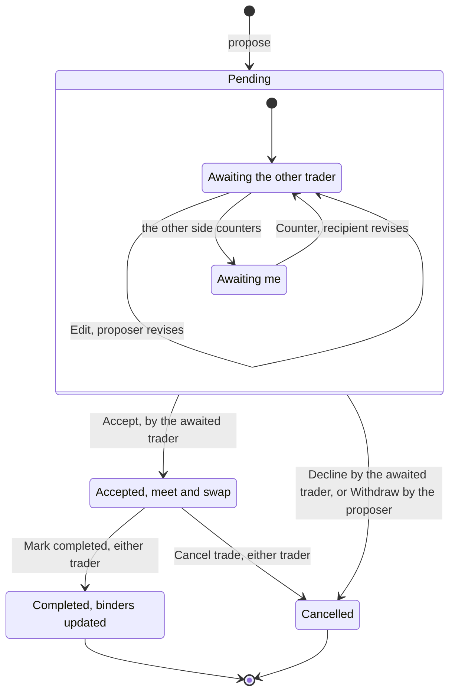
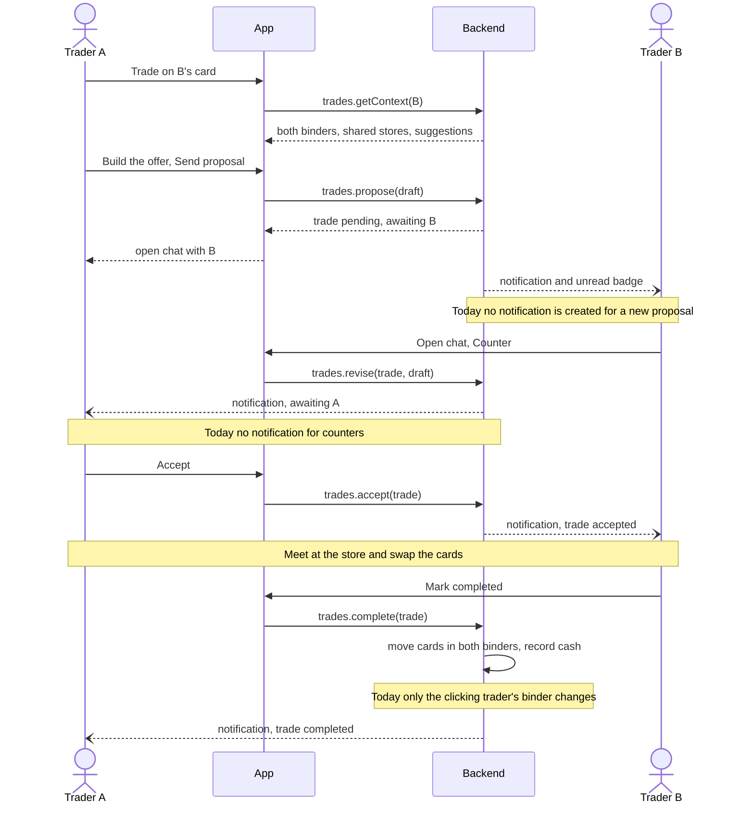

# Trading

How two traders find each other, agree on a trade and complete it in person. A trade is
negotiated inside the chat between the two traders: every proposal, counter-offer and status
change is a message in that conversation ([08-inbox-and-notifications.md](08-inbox-and-notifications.md)).

Main pieces:

| Piece | Where | File |
|---|---|---|
| Matches | `/city/$city/matched`, store pages, `/x/stores/$store` | [`MatchList.tsx`](../../src/components/trading/MatchList.tsx) |
| Trade builder (modal) | Global, opened by any Trade button | [`TradeBuilder.tsx`](../../src/components/trading/TradeBuilder.tsx) |
| Trade card | Inside the chat | [`TradeCard.tsx`](../../src/components/trading/TradeCard.tsx) |
| Trade maths | Totals, difference, perspective | [`tradeMath.ts`](../../src/lib/tradeMath.ts) |
| Rules today | `resolveDraft`, `applyCompletion`, `runPartners`, `listMatches` | [`workspace.ts`](../../src/services/mock/workspace.ts) |

## Matching rules

A **match** is another trader with whom you could swap something. `trades.listMatches(scope)` (R):

Card identity is **game + card name**, across printings. Condition, finish, language and
quantity are ignored, and so is where the item is listed. Only **haves** count on your side;
your collection does not.

A match card shows the partner (avatar, presence, profile link), "Trades at {shared stores}",
a total badge, and "They have" / "They want" previews. Actions: **Trade** (builder with all
matches pre-selected) and **Message** (`chat.openChat`).

## Opening the trade builder

Public openers go through `requireAuth('trade')`, so anonymous visitors see the sign-up
prompt and non-onboarded users go to onboarding. The match card opener does not (see gaps).

### What the builder loads: `trades.getContext(partner)` (R)

| Field | Content |
|---|---|
| `partner` | Username, avatar, presence, stores |
| `myItems` | Your collection and haves (not wants): what you can give |
| `partnerHaves`, `partnerWants` | The partner's lists |
| `sharedStores` | Stores you both joined, suggested as meetup places |
| `meetingPlaces` | Your custom places plus the partner's |
| `suggestedGet` | Partner haves whose card name is on your wants |
| `suggestedGive` | Your haves whose card name is on the partner's wants |

Errors: "You cannot trade with yourself", "Trader X not found" → "Trade unavailable" dialog.

### Pre-filled content

| Opened with | You give | You get |
|---|---|---|
| A **haves** item (someone offers it) | First 2 suggested gives | That item, quantity 1 |
| A **wants** item (someone looks for it) | Your copy of that card, plus first 2 suggested gives | — |
| `useMatches` (match card, profile Trade, chat Matches) | All suggested gives | All suggested gets |
| Plain partner (chat Trade) | First 2 suggested gives | — |
| An existing trade (Counter / Edit) | The trade's lines from your side | The trade's lines from their side |

Meetup defaults to the first shared store, otherwise a custom place (first meeting place).

### The modal

| Action | UI element | Effect | Backend touchpoint |
|---|---|---|---|
| Add a card to either side | Search box + candidate list | Line with quantity 1 at the listed price | — (draft) |
| Change quantity | Stepper (1 to available quantity) | Draft | — |
| Agree a value | Unit value input (≥ 0, step 0.01) | Draft; totals update | — |
| Remove a line | ✕ | Draft | — |
| Add cash | "I add" / "{partner} adds", amount (≥ 0, step 0.5) | Draft | — |
| Balance | "Balance" button | Sets cash to the value difference; the side with less pays | — |
| Pick the meetup | Shared store radio, or "Somewhere else" with place name, address, quick-pick chips | Draft. "You don't share a store with X yet — suggest a place." when there is none | — |
| Pick date and time | `datetime-local` | Draft | — |
| Write a note | Textarea (max 500) | Draft | — |
| Cancel | "Cancel", Esc, overlay | Closes, draft lost | — |
| Send | "Send proposal" / "Send updated proposal" (disabled when both sides are empty) | Toast "Proposal sent to X" / "Proposal updated", closes, opens `/x/inbox/$chatId` | `trades.propose(draft)` (W) or `trades.revise(tradeId, draft)` (W) |

**Server validation of a draft** (`resolveDraft`), each failure is a toast:

- Partner must exist and not be you.
- "You give" lines must be **your** collection or haves items ("Wanted cards cannot be
  offered"); quantity is capped at what you have.
- "You get" lines must be the partner's haves ("X no longer has one of these cards");
  quantity capped at theirs.
- At least one card overall ("Add at least one card to the trade").
- Prices ≥ 0, otherwise the market price is used. Cash rounded to cents, ≥ 0.
- Store meetup is re-read from the store record; custom place name required (max 80),
  address max 160. Meeting time must be a valid date (no future check). Note max 500.

## Trade lifecycle

`awaiting` is the trader who must act next: the side that did **not** make the latest offer.
Each revision swaps proposer and recipient.

| From | Transition | Who | Service | Server check | Chat event |
|---|---|---|---|---|---|
| — | Propose | Anyone, from the builder | `trades.propose` (W) | Draft valid | Trade message posted (chat created if needed) |
| Pending | Counter | Awaited trader | `trades.revise` (W) | `status = pending` (no turn check) | "sent a counter-offer" + new trade message |
| Pending | Edit | Latest proposer | `trades.revise` (W) | `status = pending` | "updated the proposal" + new trade message |
| Pending | Accept | Awaited trader | `trades.accept` (W) | pending and awaiting you, else "This trade is not waiting for you" | "accepted the trade" |
| Pending | Decline | Awaited trader | `trades.cancel` (W) | pending or accepted | "declined the trade" |
| Pending | Withdraw | Latest proposer | `trades.cancel` (W) | pending or accepted | "cancelled the trade" |
| Accepted | Cancel trade | Either | `trades.cancel` (W) | pending or accepted | "cancelled the trade" |
| Accepted | Mark completed | Either, one click | `trades.complete` (W) | accepted, else "Only accepted trades can be completed" | "marked the trade as completed" |

### The trade card in the chat

Each trade message renders a card: status pill, "You proposed" / "X proposed", meetup (store
links to `/stores/$store`), address and time, "You give" / "You get" columns (quantity,
condition, language, finish, agreed price and market price), cash line, both totals, the
difference, and the note.

| State | Footer text | Buttons |
|---|---|---|
| Pending, awaiting you | "Waiting for your answer" | **Decline** (toast "Trade declined"), **Counter** (builder), **Accept** (toast "Trade accepted") |
| Pending, awaiting them | "Awaiting @partner" | **Withdraw** (toast "Proposal withdrawn"), **Edit** (builder) |
| Accepted | "Accepted — meet up, swap the cards, then mark it completed" | **Cancel trade**, **Mark completed** (toast "Trade completed — binder updated") |
| Completed | "Completed — the cards moved between your binders" | — |
| Cancelled | "You cancelled this trade" or "X declined this trade" | — |

Status pills: Pending, Accepted, Completed, Cancelled.

### What completing a trade does (`applyCompletion`)

For the trader who clicks **Mark completed** only:

- Each card **you give** is taken from its source item (removed at 0). If it came from haves,
  one copy is also taken from a matching collection item (same card and finish).
- Each card **you get** is added to your **collection** (merged with an identical item) and
  lowers a **wants** item with the same card name.
- Cash is not recorded, the partner's binder does not change, and "completed trades" on the
  profile is not incremented.

## A full negotiation

How it should work end to end. Notes mark what the app does **today**.

In the mock, partners are simulated: about 20 s after you propose or counter, the partner
accepts automatically, replies "Sounds good, see you there!", and a "{partner} accepted your
trade" notification appears. Mock partners never propose, counter, decline or complete.

## Gaps / open questions

- **Completion is one-sided and unconfirmed.** One click by either trader closes the trade
  and only that trader's binder changes. Decide: both confirm? either confirms and both
  binders update? what if they disagree?
- **No reservation.** Cards in a pending or accepted trade can be offered elsewhere,
  edited or deleted; completion then silently skips missing items.
- **`revise` has no turn check** on the server; the UI alone separates Counter from Edit.
- **Notifications for trade events are missing**: proposal received, counter, decline,
  withdraw, cancel, completed. Only the mock auto-accept creates one.
- **Cancelled copy is wrong**: declining shows "You cancelled", and a partner withdrawing
  shows "X declined".
- **Matches skip onboarding**: the match card Trade and Message buttons have no `requireAuth`.
- **Plain Trade still pre-selects up to 2 gives**, which can surprise users.
- **Meeting time** is not checked to be in the future; no reminders exist.
- **`partnerWants`** is loaded by the builder but not shown.
- **Cash** is recorded on the trade but not tracked after completion.
- **Concurrency**: two counters at once, or accept after the other side edited, need
  versioning (for example `updatedAt` as an optimistic lock).
