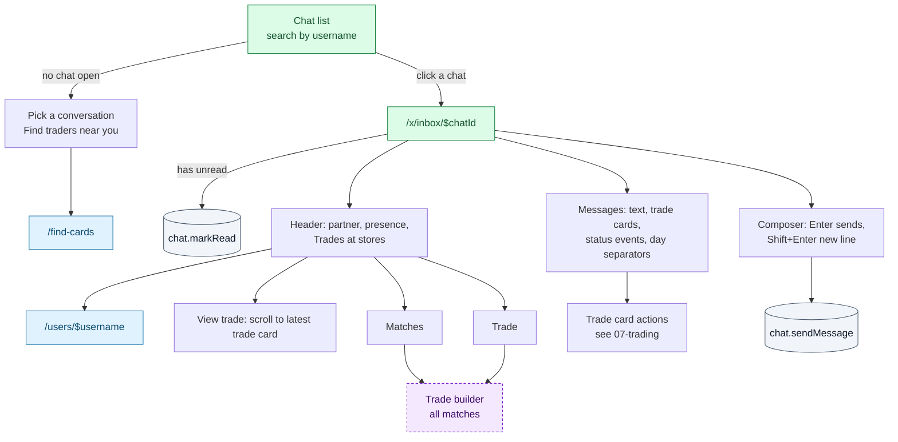
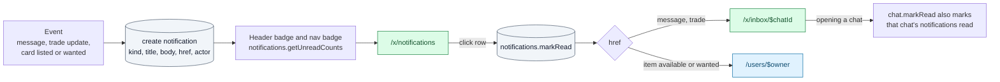

# Inbox and notifications

One-to-one conversations between traders, which also carry trade proposals, and the
notification centre. Both are ✅ Onboarded (behind the `/x` guard). Today both are
**polled**: chat list every 15 s, open conversation every 5 s, unread counts every 30 s.

## `/x/inbox` Conversations

> ✅ Onboarded · Files: [`x/inbox/route.tsx`](../../src/routes/x/inbox/route.tsx), [`index.tsx`](../../src/routes/x/inbox/index.tsx), [`$chatId.tsx`](../../src/routes/x/inbox/$chatId.tsx)
> **Arrives from** header Inbox badge, workspace nav, avatar menu, palette `G I`, any "Message" button, after sending a trade proposal, notification rows
> **Loads** `chat.listChats` (R, every 15 s); in a conversation `chat.getThread(chatId)` (R, every 5 s) and `places.listStores` (R)

### Chat list

Each row: avatar with presence dot, username (bold when unread), trade status pill of the
latest trade, relative time, preview ("You: …", "X sent a trade proposal", "X accepted the
trade"), unread count. Sorted by last activity. On mobile the list hides while a chat is open.

### Conversation

| Action | UI element | Effect | Backend touchpoint |
|---|---|---|---|
| Open a conversation | Chat list row | `/x/inbox/$chatId`; marks it read if it has unread messages | `chat.getThread` (R), `chat.markRead(chatId)` (W) |
| Search conversations | Search box | Client-side filter by username | UI only |
| Open the partner's profile | Name in the header | `/users/$username` | — |
| View trade | "View trade" (when a trade exists) | Scrolls to the latest trade card | UI only |
| Trade with all matches | "Matches" | Trade builder, all matches pre-selected | `trades.getContext` (R) |
| Start a trade | "Trade" | Trade builder | `trades.getContext` (R) |
| Act on a trade | Trade card buttons | Accept, Decline, Counter, Withdraw, Edit, Cancel, Mark completed | `trades.*` (W), see [07](07-trading.md#the-trade-card-in-the-chat) |
| Send a message | Textarea (max 2000) + Send, or Enter | Posts the message; draft cleared | `chat.sendMessage(chatId, body)` (W); empty → "Write a message first" |
| Back (mobile) | Back button | `/x/inbox` | — |

Message kinds: **text** (bubbles), **trade** (trade card), **event** (centred status note,
for example "accepted the trade"). Empty conversation: "Say hi to X, or propose a trade."

### Starting a conversation

"Message" on a profile or a match card calls `chat.openChat(partner)` (W), which returns the
existing conversation or creates an empty one, then opens `/x/inbox/$chatId`. Proposing a
trade also creates the conversation if needed.

## `/x/notifications`

> ✅ Onboarded · Search `kind` (message, trade, item-available, item-wanted), `status` (unread, read) · File: [`x/notifications.tsx`](../../src/routes/x/notifications.tsx)
> **Arrives from** header badge (when only notifications are unread), workspace nav, avatar menu, palette `G N`
> **Loads** `notifications.list({ kind, status })` (R) → items plus counts (total, unread, per kind, always unfiltered)

| Action | UI element | Effect | Backend touchpoint |
|---|---|---|---|
| Filter by kind | Counter tiles: All, Messages, Trades, Items available, Items wanted | Writes `?kind=` | `notifications.list` (R) |
| Filter by status | Tabs: All, Unread (n), Read | Writes `?status=` | `notifications.list` (R) |
| Mark all as read | "Mark all as read" (disabled with 0 unread) | All read | `notifications.markAllRead()` (W) |
| Open a notification | Row (unread rows are tinted and bold) | Marks it read if unread, then opens its link | `notifications.markRead([id])` (W) |

### Notification lifecycle

### Which events create notifications

| Kind | Should be created when | Today (mock) | Links to |
|---|---|---|---|
| `message` | The partner sends you a message | Seed data only | `/x/inbox/$chatId` |
| `trade` | You receive a proposal or counter; your proposal is accepted, declined, withdrawn, cancelled or completed | Only "X accepted your trade" from the simulated partner, plus seed data | `/x/inbox/$chatId` |
| `item-available` | Someone at your stores lists a card on your wants (respecting each store's **Match alerts** setting) | Seed data only | `/users/$owner` |
| `item-wanted` | Someone at your stores wants a card on your haves | Seed data only | `/users/$owner` |

### Unread counts

`notifications.getUnreadCounts` (R) returns `messages` (sum of unread messages across chats)
and `notifications` (unread notifications). The header shows the sum and links to
`/x/notifications` when only notifications are unread; the workspace nav shows two badges.

## Gaps / open questions

- **Notification generation does not exist.** No runtime event creates notifications except
  the mock auto-accept. The backend needs an event → notification pipeline, and probably
  email or push for important events.
- **`notifyMatches` is saved but unused.** The Store settings switch "Match alerts" has no
  effect yet.
- **Realtime.** Polling every 5–30 s should become a realtime channel (for example Supabase
  Realtime) for messages, trade updates and unread counts. Presence ("Online now", "Last
  seen") is fake today.
- **Unread rules.** Unread counts include the partner's trade and status messages, not only
  text. Opening a chat marks its notifications read. Confirm both are intended.
- **Empty chats persist.** "Message" creates a conversation even if no message is ever sent.
- **No moderation tools**: block, report, archive or delete a conversation.
- **Notification links to a profile** for item alerts; a link to the matching card or a
  pre-filled trade may be more useful.
