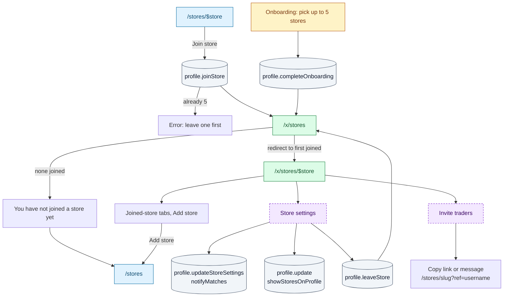

# My stores and settings

The stores you trade at (up to 5 "trading locations") and your account settings. Both are
✅ Onboarded and write through `profile.*`.

## Store membership

## `/x/stores`

> ✅ Onboarded · File: [`x/stores/index.tsx`](../../src/routes/x/stores/index.tsx)
> **Arrives from** workspace nav, avatar menu, palette, settings "Manage stores", after leaving a store
> **Loads** `profile.get` (R)

Redirects to the first joined store. With none: "You have not joined a store yet" and
"Find stores near you" → `/stores`.

## `/x/stores/$store`

> ✅ Onboarded · Param `store` · File: [`x/stores/$store.tsx`](../../src/routes/x/stores/$store.tsx)
> **Arrives from** `/x/stores`, store tabs, public store page "Joined · open"
> **Loads** `places.getStore` (R), `places.getCity` (R), `places.listStores` (R), `trades.listMatches({ storeSlug })` (R), `trading.listTradeItems({ storeSlug, listType, limit: 8 })` ×2 (R)

| Action | UI element | Effect | Backend touchpoint |
|---|---|---|---|
| Switch store | Joined-store tabs | `/x/stores/$store` | — |
| Add a store | "Add store" (fewer than 5 joined) | `/stores?city=` | — |
| Open public page | "Public page" | `/stores/$store` | — |
| Join (store opened by URL, not joined) | "Join store" | Toast "Joined {store}" | `profile.joinStore` (W) |
| Trade or message a match | "Matches (n)" (unlocked city) | Trade builder, chat | `trades.getContext` (R), `chat.openChat` (W) |
| Browse previews | "Haves" / "Wants" (8 each), "View all N →" | City-wide `/city/$city/haves` or `/wants` | — |
| Store settings | "Store settings" | Dialog below | — |
| Invite traders | "Invite traders" | Dialog below | — |

Locked city: `UnlockProgress` and `HeadStartSteps` instead of matches and previews.

**Store settings dialog**

| Control | Effect | Backend touchpoint |
|---|---|---|
| "Match alerts" switch | Saves the store's alert preference | `profile.updateStoreSettings(slug, { notifyMatches })` (W); store must be joined |
| "Show my stores on my profile" switch (all stores) | Saves profile visibility | `profile.update({ showStoresOnProfile })` (W) |
| "Leave store" | Toast "Left {store}", back to `/x/stores` | `profile.leaveStore(slug)` (W) |
| "Done" | Closes | — |

**Invite dialog**: a read-only link `/stores/<slug>?ref=<username>` with **Copy**, and a
pre-written message ("I trade cards at … join so we can swap") with **Copy message**. UI only.

## `/x/settings`

> ✅ Onboarded · File: [`x/settings.tsx`](../../src/routes/x/settings.tsx)
> **Arrives from** avatar menu "Settings", workspace nav, own profile "Edit profile"
> **Loads** `profile.get` (R), `catalogue.listGames` (R), `places.listCities` (R), `places.listStores` (R)

One form, one **Save changes** button (enabled when something changed) →
`profile.update(patch)` (W), toast "Settings saved".

| Panel | Fields | Rules (server) |
|---|---|---|
| Profile | Avatar colour (hue slider), Username (read-only), Display name, Bio | Display name required, max 40; bio max 280; hue 0–360 |
| Games | Toggle chip per game | At least one ("Pick at least one game"); unknown ids dropped |
| Pricing source | Cardmarket (EUR) / TCGplayer (USD) | Anything else falls back to Cardmarket |
| Trading | City select, Stores ({n}/5, read-only, "Manage stores" → `/x/stores`), "Show my stores on my profile", Other meeting places (chips, add up to 5, max 60 each) | City must exist; meeting places trimmed, de-duplicated, max 5 |

Changing the city does not change the joined stores.

## Gaps / open questions

- **Invite `?ref=` is not read anywhere.** Decide whether referrals are tracked (they could
  count towards unlocking a city).
- **Leaving a store** keeps its settings and does not touch pending trades that meet there.
- **City vs stores.** The profile city and the joined stores are independent: a user can
  live in Milan with all stores in Turin. Decide which one defines "trader in this city"
  for unlocking and matching.
- **Account settings are missing**: email, password, connected OAuth providers, account
  deletion, data export, notification preferences beyond per-store match alerts.
- **Games selection** is only used to rank import matches; search, matches and decks ignore it.
