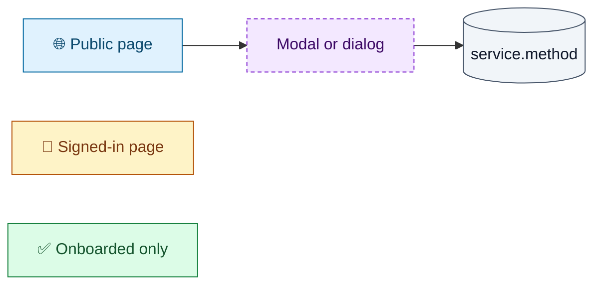
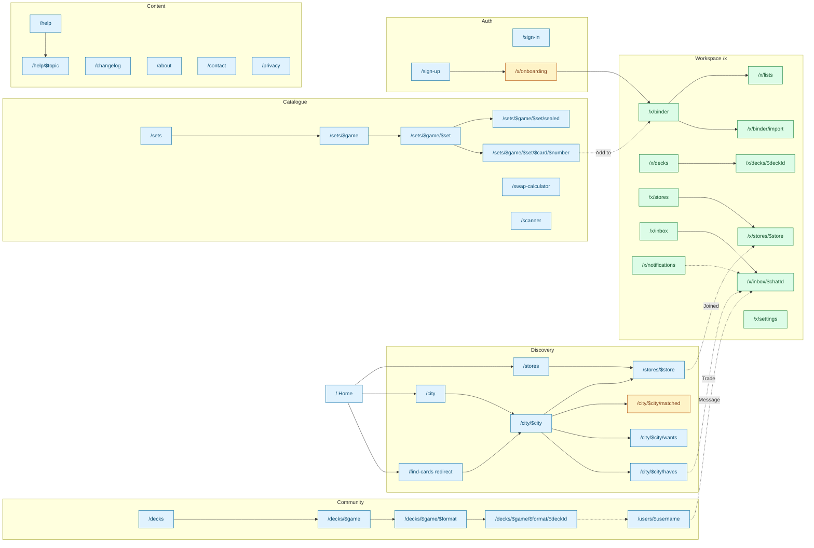
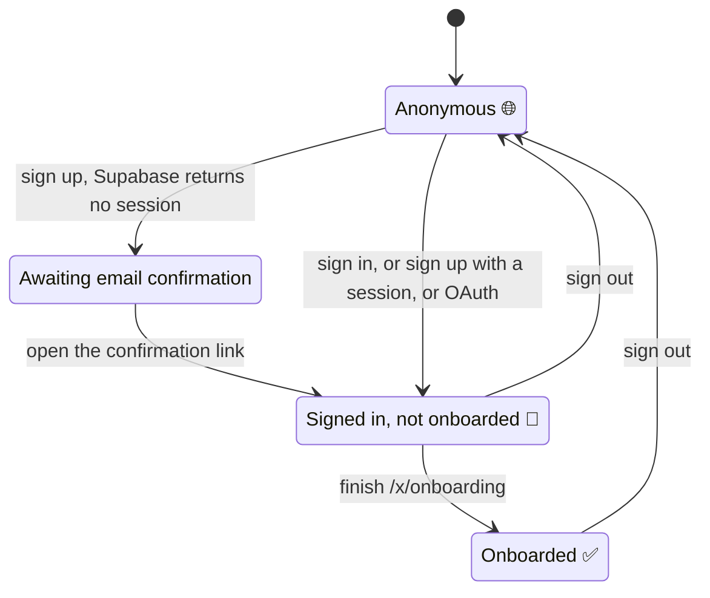

# CardNearMe user paths

What a user can do on every page, modal and component of CardNearMe, and which backend
capability each action needs. These docs exist to plan the backend: the frontend is
complete, and every read and write already goes through the service interfaces in
[`src/services/services.ts`](../../src/services/services.ts). Today those interfaces are
backed by a mock ([`src/services/mock/`](../../src/services/mock/)).

The docs describe the app **as built** on `feat/experimentation` (October 2026). Where
the UI and the mock disagree with what a real backend should do, the page lists it under
**Gaps / open questions**. [backend-touchpoints.md](backend-touchpoints.md) collects all
of those in one place.

## Contents

| File | Area | Routes |
|---|---|---|
| [00-access-and-onboarding.md](00-access-and-onboarding.md) | Viewer states, gating, sign-in, sign-up, onboarding, sign-out | `/sign-in`, `/sign-up`, `/x/onboarding`, `/x` guard |
| [01-global-chrome.md](01-global-chrome.md) | Header, avatar menu, mobile drawer, global search, command palette, shortcuts, theme, footer | `__root` |
| [02-discovery-cities-stores.md](02-discovery-cities-stores.md) | Landing page, cities, city trading lists, matches, store finder, store page | `/`, `/find-cards`, `/city/**`, `/stores/**` |
| [03-catalogue-and-tools.md](03-catalogue-and-tools.md) | Games, sets, cards, sealed products, swap calculator, scanner | `/sets/**`, `/swap-calculator`, `/scanner` |
| [04-community-and-content.md](04-community-and-content.md) | Community decks, public profiles, help centre, static pages | `/decks/**`, `/users/$username`, `/help/**`, `/changelog`, `/about`, `/contact`, `/privacy` |
| [05-binder-and-lists.md](05-binder-and-lists.md) | Binder (collection, haves, wants), trade lists, import wizard | `/x/binder`, `/x/binder/import`, `/x/lists` |
| [06-deck-builder.md](06-deck-builder.md) | My decks and the deck builder | `/x/decks`, `/x/decks/$deckId` |
| [07-trading.md](07-trading.md) | Matches, trade builder, trade negotiation and completion | global modal, trade card |
| [08-inbox-and-notifications.md](08-inbox-and-notifications.md) | Chat and notifications | `/x/inbox/**`, `/x/notifications` |
| [09-my-stores-and-settings.md](09-my-stores-and-settings.md) | Joined stores, store settings, invites, account settings | `/x/stores/**`, `/x/settings` |
| [backend-touchpoints.md](backend-touchpoints.md) | Every service method, who calls it, its rules, and all open questions | — |

## How to read these docs

### Access levels

Every route and action carries one of three access levels.

| Level | Meaning | How the UI enforces it |
|---|---|---|
| 🌐 **Public** | Anyone, including anonymous visitors | Nothing; some results are capped for anonymous visitors |
| 🔑 **Signed-in** | Has an account and a session | `SignedIn` / `SignedOut` components, `GatedPanel`, the `/x` guard |
| ✅ **Onboarded** | Signed in **and** has picked a city and stores | `requireAuth(action, run)` and the `/x` guard |

An action marked ✅ that an anonymous visitor tries opens the **sign-up prompt**. A signed-in
user who has not onboarded is sent to `/x/onboarding` and comes back afterwards. See
[00-access-and-onboarding.md](00-access-and-onboarding.md).

### Backend touchpoints

Actions name the service method they call, in the form `service.method`, followed by
**(R)** for a read or **(W)** for a write. For example:

- `catalogue.getCard` (R): read through a React Query option in [`queries.ts`](../../src/services/queries.ts).
- `trades.accept` (W): a write through `useWorkspaceMutation` in [`mutations.ts`](../../src/services/mutations.ts). After every successful write, all `['me', …]` queries are refetched; a failure shows a toast with the service's error message.
- **UI only**: the action changes nothing on the server today (copy a link, local state). Some of these need a backend later; the page says so.

### Per-page layout

Each page section follows the same order:

1. **Header block**: route, access level, URL params, where users arrive from, where they go next, and what the page loads.
2. **Action map**: a Mermaid flowchart, for pages with more than a handful of actions.
3. **Action table**: Action · UI element · Effect · Backend touchpoint · Gate.
4. **Modals** the page opens: trigger, fields, validation, outcome.
5. **Gaps / open questions**.

### Diagram colours

All diagrams use the same classes.

## Glossary

The terms used across these docs. Copied and tightened from the
[trading-shell spec](../../.scratch/trading-shell/spec.md).

| Term | Meaning |
|---|---|
| **Game** | A supported trading card game (MTG, Riftbound, One Piece, Star Wars: Unlimited, Lorcana, Dragon Ball Super Fusion World, Flesh and Blood). Each game has capabilities (catalogue, trading, deck builder, legalities, scanner) and formats. |
| **Set** | A release within a game: code, name, type, release date, card count, market cap. |
| **Card / printing** | One printing of a card in a set: collector number, rarity, finishes (non-foil, foil, etched), price per finish. Cards with the same game and name are "the same card" for ownership and matching. |
| **Sealed product** | A booster, box or bundle in a set. |
| **Binder** | The signed-in user's cards, split into three **sections**: Collection, Haves and Wants. |
| **Collection** | Cards the user owns. Not offered for trade unless also listed on a haves list. |
| **Trade list** | A named list of type **haves** (cards offered) or **wants** (cards looked for). Optionally restricted to one game; public or private. Every haves or wants card belongs to exactly one list. |
| **Binder item** | One line in the binder: a printing plus condition, finish, language and quantity. For wants, the condition is the minimum acceptable. |
| **Store** | A local game store (LGS). Users join up to 5 stores as their **trading locations**. |
| **City** | A trading hub. City-wide trading **unlocks** when the city has at least `unlockThreshold` traders (3 in the mock). |
| **Match** | Another trader who has a card on your wants, or wants a card on your haves, scoped to a city or store. |
| **Trade** | A proposal between two traders: cards each side gives, optional cash balance, meetup place and time, note. Negotiated in the chat, then completed in person. |
| **Onboarding** | First-run setup: city, up to 5 stores, profile visibility. Required before any trading action. |
| **Viewer** | Whoever is looking at the page: anonymous, signed-in, or signed-in and onboarded. |

## Site map

Every route, grouped by area. Solid arrows are the main way down the hierarchy; dotted arrows
are notable cross-links. Routes under `/x` all sit behind the `/x` guard.

Global overlays reachable from many pages: the **sign-up prompt** (any gated action), the
**trade builder** modal (any Trade button), **AddCardDialog** (binder and card page), the
**command palette** (Cmd/Ctrl+K) and **global search** (`/`).

## Viewer lifecycle

What each state can do:

| Capability | Anonymous | Signed in | Onboarded |
|---|---|---|---|
| Browse catalogue, cities, stores, decks, profiles, help | Yes | Yes | Yes |
| City haves and wants | First 30 results | All | All |
| See matches | No (sign-in panel) | Yes on `/city/$city/matched` only | Yes |
| Trade, message, join store, add to binder, like a deck | Sign-up prompt | Sent to onboarding | Yes |
| Post a deck comment | Sign-in panel | Yes | Yes |
| Own binder, lists, decks, inbox, notifications, settings (`/x/*`) | Sent to `/sign-in` | Sent to `/x/onboarding` | Yes |
| Card ownership counts and price history | Sign-up panel | Yes | Yes |
| Pricing in USD (TCGplayer) | No, always EUR | No, always EUR | If chosen in settings |
