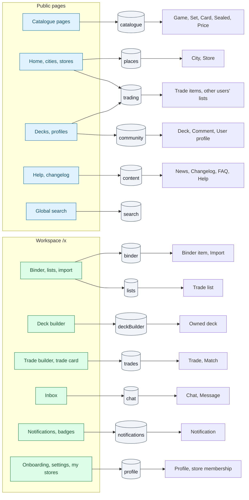

# Backend touchpoints

Every service method the frontend calls, who calls it, and the rules the mock enforces today.
This is the contract the backend has to implement. It is defined in
[`src/services/services.ts`](../../src/services/services.ts), with types in
[`types.ts`](../../src/services/types.ts), React Query options in
[`queries.ts`](../../src/services/queries.ts) and writes in
[`mutations.ts`](../../src/services/mutations.ts).

## Service map

## Cross-cutting rules

- **Workspace services act for the session user.** `binder`, `lists`, `deckBuilder`, `chat`,
  `trades`, `notifications` and `profile` never take a user id; the server resolves it from
  the session and rejects anonymous callers ("Sign in to continue"). Route guards do not
  protect data.
- **Onboarding is not checked server-side today.** The mock RPC
  ([`workspaceRpc.ts`](../../src/services/mock/workspaceRpc.ts)) only checks sign-in.
  Decide which methods require an onboarded user (at least `trades.*`, `chat.openChat`,
  `profile.joinStore`).
- **Errors are user-facing.** Every write failure shows the error's `message` as a toast,
  so messages must be short, specific and safe to show.
- **Cache keys.** Public reads are keyed by their arguments; workspace reads by
  `['me', viewerId, …]`. Every successful write refetches all `['me', …]` queries.
- **Polling today**: `chat.listChats` 15 s, `chat.getThread` 5 s,
  `notifications.getUnreadCounts` 30 s. Candidates for realtime.
- **Static data** (games, sets, cards, cities, stores, content) is cached 5 minutes on the client.

## Public services

Access 🌐 for all of them. "Callers" names the page or component.

### `catalogue`

| Method | R/W | Callers | Notes |
|---|---|---|---|
| `listGames()` | R | Almost every page (badges, filters), `/sets`, `/decks`, settings | Game capabilities drive which games appear in the deck builder, decks and scanner |
| `getGame(gameId)` | R | `/sets/$game/**`, `/decks/$game/**` | Unknown → 404 |
| `listSets(gameId, { q, sort, order })` | R | `/sets`, `/sets/$game` | Sort: name, code, releasedAt, cardCount, marketCap |
| `getSet(gameId, setCode)` | R | Set, sealed and card pages | |
| `listCards({ gameId, setCode, q, sort, order, facets })` | R | `/sets/$game/$set` | Returns items, total, facets (rarity, type, finish, color, artist). Sort: number, name, price, priceChange, rarity |
| `getCard(gameId, setCode, number)` | R | Card page | Includes prices per finish, legalities, rulings |
| `listPrintings(card)` | R | Card page, AddCardDialog | Same name, other printings |
| `listSealed(gameId, setCode)` | R | Sealed page | |
| `searchCards(q, { gameId, limit })` | R | Global search (via `search`), AddCardDialog, CardSearchBox (import, deck builder), swap calculator, deck text import | One result per game and name; default limit 8 |
| `getCardAvailability(card)` | R | Card page | Per city: haves and wants counts for the card name |

### `places`

| Method | R/W | Callers | Notes |
|---|---|---|---|
| `listCities(q?)` | R | `/city`, onboarding, settings, `/stores` chips, global search | |
| `getCity(slug)` | R | City pages, store pages, `/stores?city=` | Includes `traderCount`, `unlockThreshold` |
| `detectCity()` | R | Home, `/find-cards`, onboarding default, `/stores` default | Geo-IP in production; mock returns Vigevano |
| `listStores({ citySlug })` | R | Home, city hub, `/stores`, onboarding, matches, inbox, settings | |
| `getStore(slug)` | R | Store pages | |

### `trading`

| Method | R/W | Callers | Notes |
|---|---|---|---|
| `listTradeItems({ citySlug, storeSlug, ownerUsername, listType, q, sort, order, facets, limit })` | R | City haves / wants, store previews, profiles, `/x/stores/$store` | Other traders' haves or wants. **Anonymous cap of 30 is passed by the client as `limit`**; the backend must enforce it |
| `getCityTradeStats(citySlug)` | R | Home, city hub | Haves and wants counts |

### `community`

| Method | R/W | Callers | Notes |
|---|---|---|---|
| `listDecks({ gameId, format, ownerUsername, limit })` | R | Home, `/decks/**`, profiles | Today seed only; must include users' public decks |
| `getDeck(deckId)` | R | Deck detail | |
| `listDeckComments(deckId)` | R | Deck detail | No write method exists yet |
| `getUser(username)` | R | Profiles | Must respect list visibility and `showStoresOnProfile` |

### `content`

| Method | R/W | Callers |
|---|---|---|
| `listNews()` | R | Home |
| `listChangelog()` | R | `/changelog` |
| `listFaq()` | R | Home, `/help/faq` |
| `listHelpArticles()` | R | Help layout |
| `getHelpArticle(slug)` | R | `/help/$topic` |

### `search`

| Method | R/W | Callers | Notes |
|---|---|---|---|
| `search(q)` | R | Global search (header, mobile drawer) | Cards (6) and cities (4) |

## Workspace services

Access ✅ for all of them (the UI only reaches them after onboarding), but see the
cross-cutting note on server-side checks.

### `binder`

| Method | R/W | Callers | Rules today |
|---|---|---|---|
| `getCounts()` | R | Binder tabs | Total quantity per section |
| `listItems({ section, listId, q, sort, order, facets })` | R | Binder | Search on card and set name; facets and stats computed before filters; sort name, updated, price, quantity |
| `getOwnership(cardIds)` | R | Card page, deck builder | Copies per section across printings with the same game and name |
| `addItems(items)` | W | AddCardDialog | Card must exist; condition, finish, language valid; quantity 1–999; identical items merge; list resolved (see below) |
| `updateItem(itemId, patch)` | W | EditItemDialog | Finish must exist for the printing; list re-resolved; no merging |
| `moveItems(itemIds, { section, listId })` | W | Item menu, bulk bar | All destinations checked first (all or nothing); moves, does not copy |
| `removeItems(itemIds)` | W | Item menu, bulk delete | Hard delete; unknown ids ignored |
| `createImport({ section, listId, source, rows })` | W | Import step 1 | 1–1000 rows; server matches rows to cards (set+number, name in set, name in user's games, any name) |
| `getImport(importId)` | R | Import step 2 and 3 | Unknown → "expired" screen |
| `updateImportRow(importId, line, { cardId, include })` | W | Import step 2 | Rejected after commit; a row needs a card to be included |
| `commitImport(importId)` | W | Import step 2 | Rejected twice; defaults NM / en / non-foil; **not atomic** |

**List resolution** (add, move, update, commit): Collection has no list. A given list must
exist, match the section's type, and accept the card's game. No list given → first
compatible list, or a new public "My haves" / "My wants" list.

### `lists`

| Method | R/W | Callers | Rules today |
|---|---|---|---|
| `list({ q, type, sort, order })` | R | Binder chips, AddCardDialog, import, `/x/lists` | `cardCount` is the total quantity |
| `create({ name, type, gameId, visibility })` | W | ListFormDialog | Name required, max 60; game must exist |
| `update(listId, patch)` | W | ListFormDialog, visibility toggle | Type cannot change; game restriction rejected if the list holds other games |
| `remove(listId)` | W | `/x/lists` delete | **Deletes the list's items** |

### `deckBuilder`

| Method | R/W | Callers | Rules today |
|---|---|---|---|
| `listMine()` | R | `/x/decks` | |
| `getMine(deckId)` | R | Builder | Unknown → 404 |
| `create(input)` | W | CreateDeckDialog | Name required, max 80; game must exist; always private at creation |
| `update(deckId, input)` | W | Builder Save | Max 500 entries; quantity 1–999; sections commander, mainboard, sideboard, considering; description max 2000; **no legality check** |
| `remove(deckId)` | W | Builder Delete | |

### `chat`

| Method | R/W | Callers | Rules today |
|---|---|---|---|
| `listChats()` | R | Inbox list (15 s) | Sorted by last activity; unread counts messages from the partner after `lastReadAt` |
| `getThread(chatId)` | R | Conversation (5 s) | Messages plus the trades they reference |
| `openChat(partner)` | W | Profile and match "Message" | Returns or creates the conversation |
| `sendMessage(chatId, body)` | W | Composer | Trimmed, max 2000, not empty |
| `markRead(chatId)` | W | Opening a chat with unread messages | Also marks that chat's notifications read |

### `trades`

| Method | R/W | Callers | Rules today |
|---|---|---|---|
| `listMatches({ storeSlug, citySlug })` | R | Matched page, store pages, `/x/stores/$store` | See [matching rules](07-trading.md#matching-rules) |
| `getContext(partner)` | R | Trade builder | Not yourself; partner must exist |
| `propose(draft)` | W | Trade builder | Draft validation (see [07](07-trading.md#the-modal)); creates the chat if needed |
| `revise(tradeId, draft)` | W | Counter / Edit | Pending only; swaps proposer and recipient |
| `accept(tradeId)` | W | Trade card | Pending and awaiting you |
| `complete(tradeId)` | W | Trade card | Accepted only; moves cards in **your** binder |
| `cancel(tradeId)` | W | Decline, Withdraw, Cancel trade | Pending or accepted |

### `notifications`

| Method | R/W | Callers | Rules today |
|---|---|---|---|
| `list({ kind, status })` | R | `/x/notifications` | Counts always unfiltered |
| `getUnreadCounts()` | R | Header badge, workspace nav (30 s), `/x` loader | Messages and notifications |
| `markRead(ids)` | W | Notification row click | |
| `markAllRead()` | W | "Mark all as read" | |

### `profile`

| Method | R/W | Callers | Rules today |
|---|---|---|---|
| `get()` | R | `/x` loader, pricing context, store pages, settings, onboarding | |
| `update(patch)` | W | Settings, store settings dialog | Display name 1–40; bio max 280; hue 0–360; ≥ 1 game; city must exist; meeting places max 5 × 60 |
| `completeOnboarding({ citySlug, storeSlugs, showStoresOnProfile })` | W | Onboarding | City must exist; max 5 existing stores |
| `joinStore(slug)` | W | Store pages | Max 5 ("Leave one first"); sets city if empty |
| `leaveStore(slug)` | W | Store settings dialog | |
| `updateStoreSettings(slug, { notifyMatches })` | W | Store settings dialog | Store must be joined |

## Needed but not in the service layer yet

| Capability | Where the UI needs it | Today |
|---|---|---|
| Auth (sign up, sign in, OAuth, email confirmation, sign out) | `/sign-in`, `/sign-up`, avatar menu | Supabase Auth directly, or demo cookie |
| Onboarded flag on the session | `/x` guard, `requireAuth` | Supabase `user_metadata`, separate from `profile.onboardedAt` |
| Deck likes | Deck detail "Like" | Toast only |
| Deck comments (write) | Deck detail "Post comment" | Toast only |
| Publish user decks to community pages | `/decks/**`, profiles | Not wired |
| Contact form / store claim | `/contact` | Toast only |
| Price history | Card page | Placeholder |
| Buy / affiliate link | Card page | `#` |
| Notification generation | `/x/notifications`, badges | Mock auto-accept only |
| Realtime messages, trade updates, presence | Inbox, header | Polling, fake presence |
| Referrals (`?ref=`) | Invite dialog | Not read |
| City detection | Home, `/find-cards` | Fixed city |
| Account management (email, password, delete, export) | — | Missing |

## Gaps and open questions for backend design

Collected from every area file. Each one is a decision to take before or while designing
the backend.

**Identity and onboarding**
1. Single source of truth for "onboarded" (session claim vs `profile.onboardedAt`).
2. Which methods require onboarding server-side.
3. Username rules and whether usernames can change (they are used as ids in URLs, chats and trades).

**Data model**
4. Haves vs collection: two records (today) or one record with an offered quantity.
5. Card identity across printings is "game + name". Confirm for ownership, matching and availability.
6. Trade lists: one list per item, type fixed, optional game restriction, cascade delete.
7. Import drafts: retention, atomic commit.

**Trading integrity**
8. Completion: who confirms, and both binders updated.
9. Reservation of cards in pending or accepted trades.
10. Turn check on `revise`, optimistic locking for concurrent edits.
11. Cash: record only, or track it.
12. Completed-trade counts and reputation on profiles.

**Visibility and privacy**
13. Private lists and decks hidden from profiles, city lists, matches and previews.
14. `showStoresOnProfile` applied to public profiles and match cards.
15. Anonymous result cap enforced server-side, not via the client `limit`.

**Cities and stores**
16. Definition of `traderCount` and whether a city can lock again.
17. Whether locked cities expose haves, wants and matches at all.
18. Profile city vs joined stores: which one defines "trader in this city".
19. Store owners and claims.

**Notifications and realtime**
20. Event → notification pipeline (messages, every trade transition, item alerts honouring `notifyMatches`).
21. Email or push for important events.
22. Realtime transport for chat, trades, unread counts and presence.

**Catalogue and pricing**
23. Card data source per game, images, legalities, rulings.
24. Price feeds per pricing source (Cardmarket EUR, TCGplayer USD), per finish, with history.

**Community**
25. Likes and comments (write, moderation, gating rule).
26. Publishing user decks; legality required for public decks?
27. Chat moderation: block, report, delete.

**UI bugs found while mapping** (frontend fixes, not backend)
- Set page order toggle mismatch ([03](03-catalogue-and-tools.md)).
- Cancelled-trade copy ([07](07-trading.md)).
- Deck Like uses the comment prompt ([04](04-community-and-content.md)).
- Match cards skip `requireAuth` ([02](02-discovery-cities-stores.md)).
- Store "View all" leaves the store ([02](02-discovery-cities-stores.md)).
- `LocaleSwitcher` not mounted, mobile drawer gaps ([01](01-global-chrome.md)).
- Single-item Remove without confirmation, bulk move offers incompatible lists ([05](05-binder-and-lists.md)).
